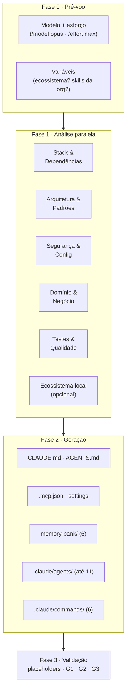
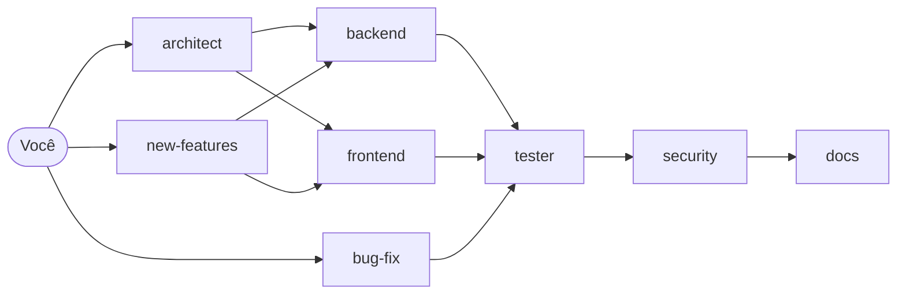
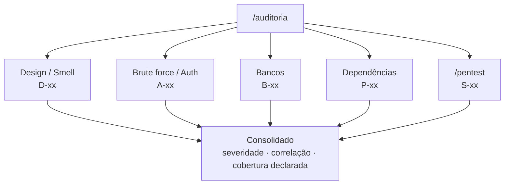

# claude-bootstrap

Configura o **Claude Code** de ponta a ponta em qualquer codebase com um comando: `/bootstrap`.

O Claude analisa o projeto com subagentes em paralelo e gera **CLAUDE.md, AGENTS.md, memory-bank,
até 11 subagentes especializados e 6 slash commands**, tudo com conteúdo real do projeto (nomes,
comandos, padrões e caminhos de verdade, sem placeholder). Junto vêm duas skills de revisão:
**auditoria técnica completa** e **pentest por contrato**.

---

## O que vem no pacote

| Skill | Comando | O que faz |
|---|---|---|
| **bootstrap** | `/bootstrap` | Analisa o repo e gera toda a estrutura de trabalho do Claude Code |
| **auditoria** | `/auditoria` | Auditoria técnica em 5 eixos (design/smell, auth, bancos, dependências, segurança) com subagentes read-only em paralelo |
| **pentest** | `/pentest` | Revisão de segurança no método de um pentest externo: inventário de rotas, 8 perguntas por rota e cards prontos para o issue tracker |

## Como funciona o `/bootstrap`



### O que é gerado no seu projeto

```
seu-projeto/
├── CLAUDE.md                 # cérebro do Claude Code (≤ 180 linhas)
├── AGENTS.md                 # referência universal (Claude, Copilot, Cursor, Windsurf)
├── .mcp.json                 # MCPs conforme a stack
├── memory-bank/
│   ├── projectBrief.md       # objetivo e escopo
│   ├── productContext.md     # negócio e fluxos
│   ├── systemPatterns.md     # arquitetura (≥ 2 diagramas Mermaid)
│   ├── techContext.md        # stack, env, setup, deploy
│   ├── activeContext.md      # foco atual (atualizado a cada sessão)
│   └── progress.md           # andamento, débitos, riscos
└── .claude/
    ├── settings.json         # permissões base + deny list + hooks (commitável)
    ├── settings.local.json   # permissões pessoais (fora do git)
    ├── agents/               # architect, backend, frontend, bug-fix, new-features,
    │                         # tester, security, reviewer, pr-writer, docs, devops
    └── commands/             # /update-memory, /security-scan, /new-feature,
                              # /bug-fix, /create-pr, /explain-codebase
```

### Os subagentes e como eles se delegam



| Agente | Papel | Escreve código? |
|---|---|---|
| `architect` | Planeja e orquestra tarefas end-to-end | Não, só delega |
| `backend` / `frontend` | Implementação na stack real | Sim |
| `bug-fix` | Reproduzir → causa raiz → correção mínima → teste de regressão | Sim |
| `new-features` | Plano aprovado → implementação delegada | Sim |
| `tester` | Testes unitários e de integração | Só testes |
| `security` | OWASP Top 10 Web + agentic/LLM, segredos, CVEs | Não |
| `reviewer` | Code review com `arquivo:linha` | Não |
| `pr-writer` | Título e corpo de PR a partir dos commits | Não |
| `docs` | Mantém o memory bank vivo | Só `.md` |
| `devops` | Docker, CI/CD, deploy | Sim |

## Diretrizes que o setup impõe

| | Diretriz | Por quê |
|---|---|---|
| **G1** | Commits e PRs **sem** trailer `Co-Authored-By` | O histórico Git fica atribuído ao autor humano |
| **G2** | Todos os agentes com o mesmo modelo (`model: opus`, alias) | Mesmo nível de raciocínio em toda a cadeia de delegação |
| **G3** | Mermaid + tabelas em vez de prosa | Diagrama envelhece melhor que texto, e a revisão humana leva segundos |

Todas são verificadas automaticamente na Fase 3. Para mudar alguma, edite
[`skills/bootstrap/referencias/diretrizes.md`](skills/bootstrap/referencias/diretrizes.md) antes de rodar.

---

## Instalação

Requer [Claude Code](https://docs.claude.com/en/docs/claude-code) e Node.js 18+.

### Opção A: instalador (recomendado)

```bash
# Em todos os projetos (~/.claude/skills)
npx github:victorbeppler/claude-bootstrap --global

# Ou só num projeto (<projeto>/.claude/skills)
npx github:victorbeppler/claude-bootstrap /caminho/do/projeto
```

| Opção | Efeito |
|---|---|
| `-g, --global` | Instala em `~/.claude/skills/` |
| `-o, --only <lista>` | Só algumas skills: `--only bootstrap,pentest` |
| `-f, --force` | Sobrescreve skills já instaladas |
| `-l, --list` | Lista as skills disponíveis |

### Opção B: copiar manualmente

```bash
git clone https://github.com/victorbeppler/claude-bootstrap.git
cp -R claude-bootstrap/skills/* ~/.claude/skills/
```

### Opção C: prompt único (copiar e colar)

Não quer instalar nada? Use o [`prompt/setup-claude.md`](prompt/setup-claude.md): é o
`/bootstrap` inteiro num só arquivo. Abra o Claude Code na raiz do projeto, ajuste as variáveis
do topo e cole o arquivo.

> Esse arquivo é **gerado** a partir de `skills/bootstrap/` (`npm run build:prompt`), então as
> duas versões nunca divergem.

## Uso

```bash
cd /caminho/do/projeto
claude
```

Dentro da sessão:

```
/model opus
/effort max
/bootstrap
```

Se o projeto faz parte de um ecossistema com repositórios irmãos (microserviços, libs
compartilhadas), informe a pasta-mãe para os agentes poderem consultar os outros projetos:

```
/bootstrap --org-path ~/projetos/minha-org
```

Para um projeto isolado: `/bootstrap --standalone`.

Depois do setup:

| Comando | Para quê |
|---|---|
| `/agents` | Confirmar que os subagentes foram carregados |
| `/explain-codebase` | Ver o projeto explicado com base no que foi gerado |
| `/security-scan` | Primeiro scan de segurança |
| `/update-memory` | Salvar o contexto da sessão no memory bank |

> **Custo:** o `/bootstrap` é uma sessão longa e com bastante raciocínio. Ele roda **uma vez por
> projeto**, e os agentes gerados é que são usados no dia a dia.

## Auditoria e pentest

As duas skills são **read-only**: leem o código, provam cada achado com `arquivo:linha` e
**descrevem** os testes ativos (brute force, IDOR, etc.) como passos para você rodar no seu
ambiente descartável. Nenhum agente dispara ataque.



O princípio das duas: **inventário antes de opinião**. Toda rodada fecha com cobertura declarada
(total / revisado / não coberto), porque revisão feita por tema parece completa e deixa passar
mais da metade.

> Use só em sistemas seus ou com autorização por escrito do dono.

## Estrutura do repositório

```
claude-bootstrap/
├── bin/init.mjs                  # instalador (zero dependências)
├── prompt/setup-claude.md        # /bootstrap em arquivo único (gerado)
├── scripts/build-prompt.mjs      # gera o prompt a partir da skill
└── skills/
    ├── bootstrap/
    │   ├── SKILL.md              # fluxo das 4 fases
    │   └── referencias/
    │       ├── diretrizes.md     # G1, G2, G3
    │       ├── arquivos-base.md  # CLAUDE.md, AGENTS.md, settings, memory-bank
    │       ├── agentes.md        # os 11 subagentes
    │       └── comandos.md       # os 6 slash commands
    ├── auditoria/
    │   ├── SKILL.md
    │   ├── eixos/                # checklist de cada eixo
    │   └── templates/            # card de achado + consolidado
    └── pentest/
        ├── SKILL.md
        ├── checklist.md          # os 8 padrões (P1–P8)
        └── templates/            # card, matriz de rotas, relatório
```

## Licença

[MIT](LICENSE)
