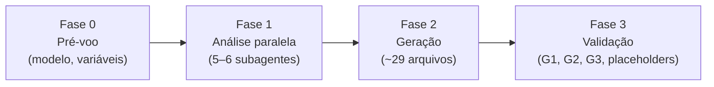
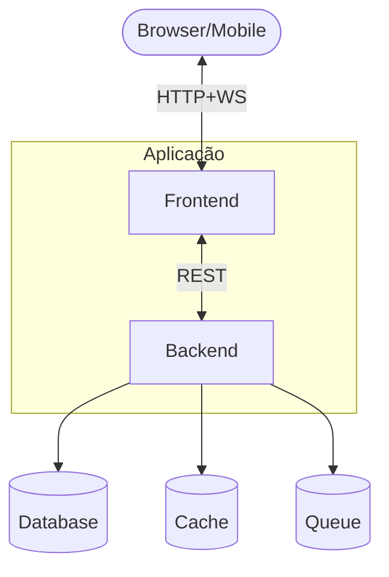
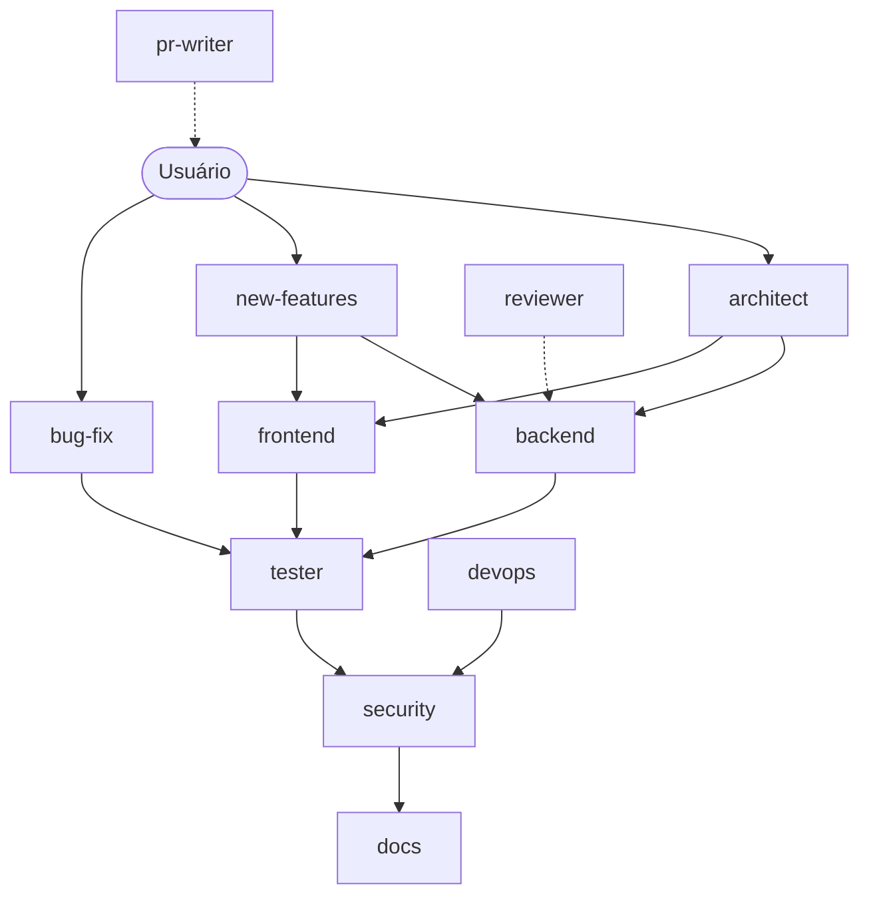

<!--
  GERADO AUTOMATICAMENTE por scripts/build-prompt.mjs a partir de skills/bootstrap/.
  Não edite este arquivo direto: edite a skill e rode `npm run build:prompt`.
-->

> **Como usar este prompt**
>
> 1. Abra o Claude Code na raiz do projeto e rode `/model opus` e `/effort max`.
> 2. Se o projeto tiver repositórios irmãos, troque `$ORG_PATH`, `$SIBLING_PROJECTS` e
>    `$ORG_SKILL_NAMESPACE` pelos valores reais (tabela da Fase 0). Se for isolado, diga
>    "projeto standalone" junto com o prompt.
> 3. Cole este arquivo inteiro.
>
> Prefere não copiar e colar? Instale a skill e rode `/bootstrap`, como explicado no README.
> Os arquivos `referencias/*.md` citados abaixo estão nos **Anexos A–D** ao final.

---

# Bootstrap do Claude Code

Analisa o projeto atual e gera toda a estrutura de trabalho do Claude Code com conteúdo
**100% específico** do projeto: nomes, comandos, padrões e caminhos reais.



| Arquivo de referência | Conteúdo | Quando ler |
|---|---|---|
| `referencias/diretrizes.md` | G1 (sem Co-Authored-By), G2 (modelo dos agentes), G3 (Mermaid + tabelas) | Antes da Fase 1 |
| `referencias/arquivos-base.md` | CLAUDE.md, AGENTS.md, .mcp.json, settings, memory-bank | Fase 2 |
| `referencias/agentes.md` | Formato e conteúdo obrigatório dos 11 subagentes | Fase 2 |
| `referencias/comandos.md` | Os 6 slash commands | Fase 2 |

## Fase 0 — Pré-voo

1. **Modelo e esforço.** Este setup gera ~29 arquivos interdependentes numa sessão longa; vale
   rodar com o modelo mais capaz disponível e esforço máximo (`/model opus` + `/effort max`).
   Se a sessão estiver num modelo menor ou com esforço baixo, **avise o usuário e pergunte se quer
   continuar** — o resultado tende a sair genérico.
2. **Variáveis do projeto.** Resolva a partir de `$ARGUMENTS`; o que faltar, detecte ou pergunte
   numa única pergunta:

   | Variável | Descrição | Exemplo | Se não houver |
   |---|---|---|---|
   | `$ORG_PATH` | Pasta-mãe dos projetos da organização | `~/projetos/minha-org/` | `--standalone`: remover Subagente 6 e toda navegação cross-project |
   | `$SIBLING_PROJECTS` | Projetos irmãos, 1 linha cada | `api-auth — Auth`, `common-lib — Shared` | Detectar listando `$ORG_PATH` |
   | `$ORG_SKILL_NAMESPACE` | Namespace de skills organizacionais | `minha-org` | Omitir `skills:` do frontmatter e `Skill` dos tools |

3. **Leia `referencias/diretrizes.md`.** G1, G2 e G3 valem para todo arquivo gerado.
4. **Arquivos existentes.** Se já houver `CLAUDE.md`, `AGENTS.md` ou `.claude/`, leia antes e
   pergunte se é para mesclar ou substituir. Nunca sobrescreva em silêncio.

## Fase 1 — Análise paralela com subagentes

Lance **em uma única leva** (um bloco de chamadas à ferramenta Agent) os subagentes abaixo, antes
de escrever qualquer arquivo. Cada um devolve um relatório estruturado.

| # | Subagente | Lê | Devolve |
|---|---|---|---|
| 1 | Stack & Dependencies Scout | Todos os manifests (`package.json`, `pyproject.toml`, `go.mod`, `Cargo.toml`, `pom.xml`, `composer.json`, `Gemfile`…) | Linguagens, frameworks, versões exatas, scripts, pacotes internos da org |
| 2 | Architecture & Patterns Scanner | Estrutura de pastas (4 níveis), entrypoints, controllers, services, repositories, models, middlewares, guards, configs | Padrão arquitetural (MVC, hexagonal, DDD, monólito modular, microserviços), camadas, convenções de nome reais, diagrama |
| 3 | Security & Config Auditor | `.env.example`, Docker, nginx, CI/CD, auth guards, CORS/CSRF/Helmet | Inventário de configs, pontos de entrada (REST, WS, GraphQL, webhooks, gRPC), riscos OWASP Top 10 |
| 4 | Business Logic & Domain Analyzer | Rotas, controllers, services, handlers | Domínios, entidades (inclusive em pacotes internos), fluxos, integrações externas, TODO/FIXME |
| 5 | Test & Quality Scanner | Configs de teste e lint, `*.spec.*`/`*.test.*`, helpers, coverage | Framework, localização dos testes, cobertura, padrões de mock/factory, gaps |
| 6 | Local Ecosystem Discovery *(opcional)* | `$ORG_PATH`: `package.json`, `README.md`, `AGENTS.md` de cada irmão | Mapa do ecossistema, dependências cruzadas, comunicação entre serviços |

> O Subagente 6 só existe se o projeto faz parte de um ecossistema. Os agentes podem **ler**
> livremente em `$ORG_PATH`, mas nunca modificar arquivos fora do projeto atual sem aprovação.

## Fase 2 — Gerar os arquivos

**Checkpoint antes de escrever:** todos os relatórios voltaram? Há dados reais suficientes? Se
faltar algo, lance análise adicional — **não use placeholder**.

Gere na ordem abaixo, seguindo as referências:

| Ordem | Arquivo(s) | Referência |
|---|---|---|
| 1 | `CLAUDE.md` (≤ 180 linhas) | `arquivos-base.md` |
| 2 | `AGENTS.md` | `arquivos-base.md` |
| 3 | `.mcp.json` | `arquivos-base.md` |
| 4–5 | `.claude/settings.json` (commitável) e `.claude/settings.local.json` (pessoal) | `arquivos-base.md` |
| 6–11 | `memory-bank/` — 6 arquivos (≤ 150 linhas cada) | `arquivos-base.md` |
| 12–22 | `.claude/agents/` — até 11 subagentes | `agentes.md` |
| 23–28 | `.claude/commands/` — 6 slash commands | `comandos.md` |

## Fase 3 — Validação e relatório final

Releia **todos** os arquivos gerados e rode:

```bash
# Placeholders que sobreviveram (deve voltar vazio)
grep -rnE '\[(nome real|stack|Nome Real)[^]]*\]|\$ORG_PATH|\$SIBLING_PROJECTS|\$ORG_SKILL_NAMESPACE' \
  CLAUDE.md AGENTS.md memory-bank/ .claude/

# G1 — Co-Authored-By só pode aparecer como proibição
grep -rn "Co-Authored-By" .claude/ CLAUDE.md AGENTS.md

# G2 — todo agente com o mesmo modelo (deve voltar uma única linha)
grep -h "^model:" .claude/agents/*.md | sort -u

# G3 — Mermaid obrigatório
grep -q '```mermaid' CLAUDE.md || echo "FALHA G3: CLAUDE.md sem mermaid"
grep -q '```mermaid' AGENTS.md || echo "FALHA G3: AGENTS.md sem mermaid"
[ "$(grep -c '```mermaid' memory-bank/systemPatterns.md)" -ge 2 ] \
  || echo "FALHA G3: systemPatterns.md precisa de ≥ 2 mermaid"
```

Confira também: cada agente tem `description` precisa (é o gatilho de auto-delegação) e só os
`tools`/`skills` de que realmente precisa.

Entregue ao usuário:

1. **Inventário** — tabela com cada arquivo criado e seu propósito.
2. **Resultado das verificações** acima (placeholders, G1, G2, G3).
3. **Top 3 riscos de segurança** encontrados na análise.
4. **Recomendações imediatas** — o que fazer primeiro com os agentes.
5. **Comandos para começar:** `/agents`, `/security-scan`, `/explain-codebase`, `/update-memory`.
6. **Perguntas para o desenvolvedor** — o que não foi possível inferir do código.

## Regras desta execução

- **Conteúdo:** 100% específico do projeto. Zero placeholder, zero texto genérico.
- **Análise:** subagentes em paralelo; diante de ambiguidade, pesquise mais em vez de assumir.
- **Agentes:** `description` precisa; tools mínimos; protocolo de pesquisa autônoma ("não pergunte
  ao usuário o que pode ser pesquisado"); proibição de lint automático em todo agente que escreve
  código; nunca reformatar código existente.
- **Estrutura:** `CLAUDE.md` ≤ 180 linhas, detalhes vão para `memory-bank/` referenciados com `@path`.
- **Permissões:** `settings.json` = base + deny list + hooks (commitável); `settings.local.json` =
  MCPs, skills, GitHub CLI, domínios de WebFetch (pessoal, no `.gitignore`).

---

# Anexo A — Diretrizes globais (G1, G2, G3) (`referencias/diretrizes.md`)

Valem em toda execução e **devem ser propagadas** para os arquivos gerados (CLAUDE.md, AGENTS.md,
agentes e commands).

## G1 — Commits sem `Co-Authored-By`

- **Nunca** adicionar o trailer `Co-Authored-By:` em mensagens de commit ou PR geradas pelo Claude
  Code ou por subagentes (inclui `Co-Authored-By: Claude` e qualquer variação).
- **Onde aplicar:**

  | Arquivo | Seção |
  |---|---|
  | `CLAUDE.md` | Proibições Absolutas |
  | `AGENTS.md` | Convenções › Commits |
  | Agentes `backend`, `frontend`, `bug-fix`, `new-features`, `pr-writer`, `devops`, `architect` | Linha: "NUNCA inclua o trailer Co-Authored-By em sugestões de commit ou PR." |
  | Agente `reviewer` | Item de checklist: trailer presente → CRÍTICO |
  | Command `/create-pr` | Passo obrigatório |

- **Por quê:** o histórico Git fica atribuído exclusivamente ao autor humano que fez o commit.

## G2 — Mesmo modelo em todos os agentes

- Todo `.claude/agents/*.md` tem `model: opus` no frontmatter. Sem mistura de `sonnet`/`haiku`.
- `CLAUDE.md` deve registrar: "Todos os agentes têm `model: opus` no frontmatter (alias para o Opus
  mais recente)". `AGENTS.md` deve registrar: "Modelo padrão dos subagentes: `model: opus`".
- **Use alias no frontmatter** (`opus`, `sonnet`, `haiku`, `inherit`), não o ID completo do modelo.
  O alias acompanha a versão mais recente sem precisar editar os agentes.
- Para reduzir custo numa chamada específica, o usuário faz override manual; o padrão continua `opus`.
- **Por quê:** coerência — todos os agentes raciocinam no mesmo nível, sem regressão quando um
  agente "leve" precisa entender contexto pesado.

> Quer outra política (ex.: `sonnet` nos agentes de leitura)? Troque aqui **antes** de rodar; a
> validação da Fase 3 só exige que todos os agentes usem o mesmo valor.

## G3 — Visualização obrigatória (Mermaid + tabelas)

Documentação em prosa pura é frágil. Diagramas e tabelas reduzem ambiguidade e tornam a revisão
humana viável em segundos.

**Ordem de preferência:** Mermaid → tabela Markdown → bloco de código → árvore ASCII → callout
(`> NOTE:` / `> WARNING:`). Prosa só para o contexto que o diagrama não captura.

| Contexto | Tipo Mermaid | Onde |
|---|---|---|
| Arquitetura de alto nível | `flowchart TB` | `CLAUDE.md` (resumo), `systemPatterns.md` (detalhe) |
| Fluxo de request | `sequenceDiagram` | `systemPatterns.md`, agentes `architect`/`backend` |
| Máquina de estados | `stateDiagram-v2` | `systemPatterns.md` |
| Modelo de dados | `erDiagram` | `systemPatterns.md`, agente `backend` |
| Hierarquia de módulos | `classDiagram` | `systemPatterns.md` |
| Filas / workers | `flowchart LR` com subgraphs | `systemPatterns.md` |
| Deploy / CI-CD | `flowchart LR` | `techContext.md`, agente `devops` |
| Roadmap | `gantt` ou tabela de status | `progress.md` |
| Decisões e trade-offs | Tabela comparativa | `productContext.md`, agente `architect` |

**Mínimos obrigatórios:**

| Arquivo | Exigência |
|---|---|
| `CLAUDE.md` | ≥ 1 `flowchart TB` da arquitetura (ASCII só como complemento) |
| `AGENTS.md` | ≥ 1 Mermaid da estrutura de pastas + tabela de comandos |
| `memory-bank/systemPatterns.md` | ≥ 2 Mermaid: arquitetura expandida, fluxo principal; + estados, ER e filas quando existirem |
| `memory-bank/techContext.md` | Mermaid de deploy (se pipeline não trivial) + tabela de stack com versões |
| `memory-bank/progress.md` | Tabela `Status \| Item \| Owner \| Data` no lugar de bullets soltos |
| Agentes de fluxo (`architect`, `backend`, `bug-fix`, `new-features`, `devops`) | ≥ 1 Mermaid do fluxo de trabalho ou do domínio |

**Esqueleto da seção de arquitetura no `CLAUDE.md`:**

````markdown
## Arquitetura



[3–5 linhas sobre os trade-offs que o diagrama não captura]
````

---

# Anexo B — Arquivos base (`referencias/arquivos-base.md`)

Tudo entre `[colchetes]` é instrução de preenchimento — **substitua por conteúdo real** da análise.
Nenhum colchete pode sobreviver no arquivo final.

## 1. `CLAUDE.md` (raiz)

O "cérebro" do Claude Code. Enxuto: **no máximo 180 linhas**. O que não couber vai para
`memory-bank/` e é referenciado com `@path`.

````markdown
# CLAUDE.md — [nome real do projeto]
> Última atualização: [data]

## Memory Bank
Leia no início de cada sessão, nesta ordem:
1. @memory-bank/projectBrief.md
2. @memory-bank/systemPatterns.md
3. @memory-bank/techContext.md
4. @memory-bank/activeContext.md
5. @memory-bank/progress.md

Ao finalizar tarefas complexas, delegue ao subagente `docs` a atualização de
activeContext.md e progress.md.

## Arquitetura
```mermaid
[flowchart TB real — camadas, módulos, integrações externas]
```
[3–5 linhas: padrão arquitetural e trade-offs]
Detalhes em @memory-bank/systemPatterns.md

## Stack & Comandos Rápidos
[Stack: linguagem vX, framework vY, banco Z, cache W]

| Ação | Comando |
|---|---|
| [dev, build, test, lint, format, cli — comandos reais] | |

Setup completo em @memory-bank/techContext.md

## Regras de Código — Não Negociáveis
[5–8 regras extraídas dos padrões reais. Ex.: "Controllers nunca acessam Repository
diretamente — sempre via Service"]

## Segurança Obrigatória
[3–5 regras da análise. Ex.: "Nunca logar tokens ou senhas"]

## Proibições Absolutas
[5–7 itens. Ex.: "Nunca usar synchronize: true no ORM", "Nunca push --force em main"]
- **Nunca adicionar trailer Co-Authored-By em commits — nem do Claude, nem de agente** (G1)

## Subagentes Disponíveis
> Todos os agentes têm `model: opus` no frontmatter — alias para o Opus mais recente (G2).

| Agente | Quando é acionado |
|---|---|
| `architect` | Tarefas end-to-end com múltiplos especialistas |
| `backend` | Implementação [stack real] |
| `frontend` | Implementação [stack real] — só se houver frontend |
| `bug-fix` | Diagnóstico e correção com causa raiz e regressão |
| `new-features` | Planejamento e implementação de features end-to-end |
| `tester` | Testes com [framework real] |
| `security` | Auditoria OWASP e de segredos |
| `reviewer` | Code review de diffs/PRs |
| `pr-writer` | Título e corpo de PR a partir dos commits |
| `docs` | Documentação e memory bank |
| `devops` | Docker, CI/CD, infra e deploy |

## MCP Disponível
[MCPs configurados. Se nenhum, remover a seção]

## Navegação Cross-Project
[Só se houver ecossistema: agentes podem ler projetos em `$ORG_PATH` para consultar
entidades, contratos de API e padrões. Se standalone, remover a seção]

## Armadilhas Deste Projeto
[3–5 pegadinhas reais. Ex.: "Entidades vêm de @org/common-lib, não de src/"]
````

## 2. `AGENTS.md` (raiz)

Arquivo universal, lido também por Copilot, Cursor, Windsurf e outros agentes.

````markdown
# [Nome do Projeto] — Agent Reference

## Visão Geral
[2 frases sobre o que o projeto faz]

## Setup Rápido
[Comandos reais para clonar, instalar e rodar]

## Estrutura de Pastas
```mermaid
[flowchart TB das pastas principais]
```

## Comandos Disponíveis
| Comando | Descrição |
|---|---|
| [todos os scripts reais] | |

## Convenções
### Arquivos
[Padrões reais de nome: controllers, services, repos, DTOs, testes]
### Classes
[PascalCase, tokens de injeção, constantes]
### Commits
[Conventional commits, padrão de branch]
- **Sem trailer `Co-Authored-By:` — apenas o autor humano** (G1)

## Notas para Agentes de IA
- **Modelo padrão dos subagentes:** `model: opus` no frontmatter (G2)
- [Arquivos críticos que não se altera sem entender por completo]
- [Onde as entidades são definidas]
- [Lint automático: proibido ou não, e por quê]
- [Endpoints e seus guards]
````

## 3. `.mcp.json` (raiz)

```json
{
  "mcpServers": {}
}
```

Adicione MCPs conforme a stack detectada. Exemplo (PostgreSQL):

```json
{
  "mcpServers": {
    "postgres": {
      "command": "npx",
      "args": ["-y", "@modelcontextprotocol/server-postgres", "${DATABASE_URL}"]
    }
  }
}
```

> Nunca escreva credencial no `.mcp.json` — ele é commitado. Use variável de ambiente.

## 4. `.claude/settings.json` (commitável)

Permissões base, deny list e hooks. Ajuste ao package manager real (npm/yarn/pnpm/pip/cargo…).
Se o projeto for standalone, remova as linhas de `$ORG_PATH`.

```json
{
  "permissions": {
    "allow": [
      "WebFetch",
      "WebSearch",
      "Bash(git status*)",
      "Bash(git log*)",
      "Bash(git diff*)",
      "Bash(git branch*)",
      "Bash(git checkout*)",
      "Bash(git add*)",
      "Bash(git commit*)",
      "Bash(npm run*)",
      "Bash(npm test*)",
      "Bash(npm install*)",
      "Bash(npm audit*)",
      "Bash(npx *)",
      "Bash(cat $ORG_PATH*)",
      "Bash(ls $ORG_PATH*)",
      "Bash(find $ORG_PATH*)",
      "Bash(grep * $ORG_PATH*)"
    ],
    "deny": [
      "Bash(rm -rf *)",
      "Bash(curl * | bash)",
      "Bash(git push --force*)",
      "Bash(git reset --hard*)"
    ]
  },
  "hooks": {
    "Stop": [
      {
        "matcher": "",
        "hooks": [
          {
            "type": "command",
            "command": "echo '💾 Sessão encerrada. Rode /update-memory para salvar o contexto.'"
          }
        ]
      }
    ]
  }
}
```

## 5. `.claude/settings.local.json` (pessoal — adicionar ao `.gitignore`)

Permissões expandidas: GitHub CLI, domínios de documentação, MCPs e skills da organização.
Remova o que não se aplica.

```json
{
  "permissions": {
    "allow": [
      "WebFetch(domain:github.com)",
      "WebFetch(domain:[docs do framework real])",
      "Bash(gh pr:*)",
      "Bash(gh repo:*)",
      "Bash(git:*)",
      "Bash(node:*)",
      "mcp__[servidor]__[tool]",
      "Skill($ORG_SKILL_NAMESPACE:[skill])"
    ]
  },
  "enabledMcpjsonServers": []
}
```

> Para MCPs como Jira/Atlassian, prefira permissões granulares por tool
> (`mcp__claude_ai_Atlassian__getJiraIssue`, `...searchJiraIssuesUsingJql`) em vez de liberar o
> servidor inteiro.

## 6–11. `memory-bank/` (6 arquivos, ≤ 150 linhas cada)

| Arquivo | Conteúdo |
|---|---|
| `projectBrief.md` | Objetivo, problema que resolve, stakeholders, escopo, posição no ecossistema |
| `productContext.md` | Contexto de negócio, fluxos principais (das rotas/controllers), integrações, decisões de produto (tabela de trade-offs) |
| `systemPatterns.md` | Arquitetura expandida (≥ 2 Mermaid), design patterns com caminhos reais, fluxo entre camadas, convenções com exemplos, passo a passo para criar endpoint/serviço/módulo |
| `techContext.md` | Stack com versões exatas (tabela), variáveis do `.env.example` com descrição, setup local, como rodar/testar/buildar/deployar, dependências críticas, pacotes internos |
| `activeContext.md` | Estado atual — template abaixo |
| `progress.md` | Andamento — template abaixo |

### `memory-bank/activeContext.md`

```markdown
# Active Context
> Atualizado em: [data] | Atualizar ao fim de cada sessão

## Foco Atual
[Inferido do código mais recente, TODOs, branch atual]

## Arquivos Mais Ativos
[De git log, imports, tamanho, complexidade]

## Tarefas em Andamento
- [ ] [Inferidas de TODO/FIXME e do nome da branch]

## Decisões Pendentes
[Arquiteturais/técnicas não resolvidas]

## Próximos Passos Sugeridos
[3–5 sugestões]
```

### `memory-bank/progress.md`

```markdown
# Progress
> Atualizar ao finalizar features ou sessões longas

| Status | Item | Owner | Data |
|---|---|---|---|
| ✅ Implementado | | | |
| 🔄 Em desenvolvimento | | | |
| ❌ Ausente / planejado | | | |

## 🐛 Débitos Técnicos
[TODOs críticos, dependências desatualizadas, code smells]

## 🔐 Riscos de Segurança Identificados
[Do Security Auditor]
```

---

# Anexo C — Subagentes (`.claude/agents/`) (`referencias/agentes.md`)

Até 11 agentes. Gere `frontend` só se houver frontend; gere `devops` só se houver infra/CI.



## Formato obrigatório

```yaml
---
name: nome-do-agente
description: >
  [Gatilho PRECISO de auto-delegação. Ex.: "quando implementar endpoints REST com
  Express", nunca "agente backend"]
tools: Read, Write, Edit, Bash, Glob, Grep, Agent, Skill, WebFetch, WebSearch
model: opus
skills:
  - $ORG_SKILL_NAMESPACE:skill-name   # só as que este agente usa
---
[Prompt do agente em Markdown]
```

## Regras para todos os agentes

| Regra | Detalhe |
|---|---|
| G2 | `model: opus` em todos, sem exceção |
| `description` | É o gatilho. Precisa = acionado certo. Vaga = nunca acionado |
| `tools` mínimos | Quem só lê não recebe `Write`/`Edit` |
| `Agent` | Obrigatório em quem orquestra outros agentes |
| `WebFetch`/`WebSearch` | Obrigatório em quem pesquisa |
| `skills:` | Só as necessárias; sem skills da org → omitir `skills:` e tirar `Skill` dos tools |
| Pesquisa autônoma | "Não pergunte ao usuário o que pode ser pesquisado na internet" |
| Lint | Todo agente que escreve código: "Nunca executar lint/eslint/prettier sem pedido do usuário" |
| Formatação | Nunca reformatar código existente fora do escopo |
| Cross-project | Se ecossistema: pode **ler** `$ORG_PATH`; nunca modificar fora do projeto sem aprovação |
| G1 | Agentes que sugerem commit/PR: "NUNCA inclua o trailer Co-Authored-By" |
| G3 | `architect`, `backend`, `bug-fix`, `new-features`, `devops`: ≥ 1 Mermaid no prompt |

---

## `architect`

```yaml
name: architect
description: >
  Invocar para tarefas que exigem múltiplas especialidades ou mexem na arquitetura:
  features completas end-to-end, refatorações grandes, escopo que toca backend +
  segurança + testes ao mesmo tempo, criação de módulos ou mudança na comunicação
  entre módulos.
tools: Read, Write, Edit, Bash, Glob, Grep, Agent, Skill, WebFetch, WebSearch
model: opus
```

O prompt deve conter:
- **Persona:** líder técnico sênior que conhece todo o projeto e o ecossistema.
- **Início:** ler `activeContext.md` + `systemPatterns.md`; se houver MCP de tickets, puxar o contexto do ticket.
- **Delegação explícita:** backend → `backend`; frontend → `frontend`; testes → `tester` (após implementar); segurança → `security` (antes de marcar pronto); memory bank → `docs` (ao final).
- **Nunca implementa código diretamente** — planeja e orquestra.
- **Finalização:** aguardar subagentes, consolidar, instruir `docs`. G1 em qualquer sugestão de commit.

## `backend`

```yaml
name: backend
description: >
  Invocar para implementar código [stack backend real]: endpoints REST, handlers
  WebSocket, services, repositories, DTOs, guards, middlewares, migrations e
  integrações com APIs externas. Também para debugging de erros de servidor.
tools: Read, Write, Edit, Bash, Glob, Grep, Skill, WebFetch, WebSearch
model: opus
```

O prompt deve conter:
- **Persona:** engenheiro backend sênior na stack real.
- **Padrões da organização:** envelope de resposta, webhooks, pacotes compartilhados (se houver).
- **Passo a passo de novo endpoint** e **template de novo service** com caminhos reais (DTO → Service → Controller → Module; logger, DI, tratamento de erro).
- **Regras:** controllers magros, DTO com validação, config via serviço de configuração (nunca `process.env` solto nem valor hardcoded).
- Proibição de lint automático; G1.
- **Finalização:** reportar e delegar `tester` e `security`.

## `frontend` *(só se houver frontend)*

```yaml
name: frontend
description: >
  Invocar para criar/editar componentes [framework UI real], páginas, estilos,
  formulários, integração com APIs, estado global e acessibilidade.
tools: Read, Write, Edit, Bash, Glob, Grep, Skill, WebFetch, WebSearch
model: opus
```

O prompt deve conter: stack de UI real, design system (se houver), padrões de componente do
projeto, pesquisa em docs oficiais/acessibilidade, proibição de lint automático, G1, e delegação
ao `tester` para testes de componente.

## `bug-fix`

```yaml
name: bug-fix
description: >
  Invocar para diagnosticar e corrigir bugs, erros de runtime, testes falhando,
  problemas de integração e regressões. Use proativamente diante de stack trace,
  erro 4xx/5xx recorrente ou bug reportado em ticket.
tools: Read, Write, Edit, Bash, Glob, Grep, Skill, WebFetch, WebSearch
model: opus
```

O prompt deve conter:
- **Persona:** especialista em debugging de produção, foco em causa raiz.
- **Fluxo obrigatório:** Reproduzir → Diagnosticar (causa raiz) → Correção mínima → Validar → Prevenir (teste de regressão).
- Nunca reformatar código existente; proibição de lint automático; G1.
- **Entrega:** Sintoma → Causa raiz → Correção → Validação → Risco residual.
- **Finalização:** delegar `tester`, `security` (se tocar auth/upload/webhook) e `docs`.

## `new-features`

```yaml
name: new-features
description: >
  Invocar para planejar e implementar features completas end-to-end — endpoints,
  services, repositories, DTOs, integrações e testes. Use quando houver ticket de
  feature, história de usuário ou requisito funcional novo.
tools: Read, Write, Edit, Bash, Glob, Grep, Agent, Skill, WebFetch, WebSearch
model: opus
```

O prompt deve conter:
- **Persona:** líder técnico que planeja, valida e orquestra.
- **Análise de impacto cross-service** (se ecossistema): ler projetos irmãos, contratos e entidades.
- **Fluxo obrigatório:** (1) plano com arquivos, módulos, DTOs, migrations e impacto → **aprovação do usuário**; (2) implementação delegada; (3) consolidação com build e testes.
- Nunca reformatar código existente; proibição de lint automático; G1.

## `tester`

```yaml
name: tester
description: >
  Invocar para escrever testes unitários e de integração com [framework real],
  analisar cobertura, achar código sem teste e rodar a suíte reportando falhas.
tools: Read, Write, Edit, Bash, Glob, Grep, Skill, WebFetch, WebSearch
model: opus
```

O prompt deve conter: framework e config reais, comandos reais, onde ficam os testes
(colocados ou separados), helpers/factories/mocks existentes, template Arrange/Act/Assert,
domínios do negócio para cenários realistas. **Nunca modifica código de produção** — só
`*.spec.*`/`*.test.*`. Finaliza rodando a suíte e reportando cobertura.

## `security`

```yaml
name: security
description: >
  Invocar para revisão de segurança de código novo ou existente: vulnerabilidades,
  autenticação/autorização, exposição de segredos, conformidade OWASP/LGPD/GDPR e
  dependências com CVE conhecida.
tools: Read, Glob, Grep, Bash, Skill, WebFetch, WebSearch
model: opus
```

O prompt deve conter:
- **Persona:** especialista em segurança ofensiva e defensiva; pensa como atacante.
- **Pesquisa:** dependência com versão → buscar CVE (NVD, GitHub Advisories); padrão de auth → OWASP Cheat Sheet.
- **OWASP Top 10 Web** em toda revisão: Broken Access Control (guards, IDOR, CORS), Cryptographic Failures, Injection (SQL, XSS, command, SSTI), Insecure Design (rate limit), Misconfiguration (Helmet, CORS, Swagger em prod), Vulnerable Components, Auth Failures (JWT, expiração), Integrity (CI/CD, supply chain), Logging Failures, SSRF.
- **OWASP Top 10 para aplicações agênticas/LLM** quando houver código de agentes: prompt injection, uso indevido de tools, abuso de privilégio, exfiltração de dados, autonomia excessiva.
- Checklist de segredos.
- **Saída por severidade:** 🔴 Crítico → 🟠 Alto → 🟡 Médio → 🔵 Baixo → ✅ Pontos positivos → 🔧 Recomendações.
- **Nunca modifica código** — só analisa e reporta.

## `reviewer`

```yaml
name: reviewer
description: >
  Invocar para code review de pull requests, diffs ou código recém-escrito:
  qualidade, padrões do projeto, segurança básica, performance e sugestões.
tools: Read, Glob, Grep, Bash, Skill, WebFetch, WebSearch
model: opus
```

O prompt deve conter: checklist (camadas, convenções REST, padrões do projeto, integrações,
código compartilhado, qualidade, segurança básica, performance); item G1 — "commit/PR com
trailer Co-Authored-By → CRÍTICO"; saída CRÍTICO / ATENÇÃO / SUGESTÃO / Pontos positivos com
`arquivo:linha`. **Nunca modifica código.**

## `pr-writer`

```yaml
name: pr-writer
description: >
  Invocar para gerar título e corpo de Pull Request a partir dos commits da branch
  atual. Agrupa mudanças por tema e segue o template do time. Só gera o texto —
  não cria o PR.
tools: Read, Glob, Grep, Bash, Skill, WebFetch, WebSearch
model: opus
```

O prompt deve conter:
- **Execução:** coletar branch, commits, diff stat e diff; analisar tipo, motivação, solução e riscos; extrair ID do ticket do nome da branch.
- **Template do PR:** Tipo de mudança, Por quê, Link do ticket, Como resolve, Evidências visuais, Como verificar, Notas de deploy, Checklist.
- **G1 crítico:** nunca incluir `Co-Authored-By` no texto nem sugerir commit com ele; se algum commit da branch tiver o trailer, alertar no output.

## `docs`

```yaml
name: docs
description: >
  Invocar para atualizar a documentação: memory bank (activeContext.md, progress.md),
  docstrings/JSDoc e changelog. Também ao final de qualquer sessão de implementação.
tools: Read, Write, Edit, Glob, Grep
model: opus
```

O prompt deve conter: protocolo de atualização para cada arquivo de `memory-bank/`; manter cada
arquivo ≤ 150 linhas; **nunca modifica lógica** — só `.md` e comentários.

## `devops` *(só se houver infra/CI)*

```yaml
name: devops
description: >
  Invocar para infraestrutura: Dockerfiles, docker-compose, pipelines de CI/CD,
  scripts de deploy, configuração de ambiente, monitoramento e problemas de build
  ou deploy.
tools: Read, Write, Edit, Bash, Glob, Grep, Skill, WebFetch, WebSearch
model: opus
```

O prompt deve conter: tabela da infra real (runtime, banco, cache, filas, imagens base);
Mermaid do pipeline; boas práticas (multi-stage, non-root, segredos fora da imagem, audit
bloqueante no CI); template de CI se não houver (install → lint → test → audit → build →
deploy); G1; delegar `security` em mudanças críticas.

---

# Anexo D — Slash commands (`.claude/commands/`) (`referencias/comandos.md`)

Cada arquivo `.md` tem frontmatter YAML + prompt e é invocado com `/nome-do-arquivo`.
`$ARGUMENTS` recebe o que o usuário digitar depois do comando.

| Comando | Delega para | Para quê |
|---|---|---|
| `/update-memory` | `docs` | Salvar o que foi feito na sessão no memory bank |
| `/security-scan` | `security` | Scan OWASP do projeto ou de um arquivo |
| `/new-feature` | `architect` / `new-features` | Feature end-to-end com plano aprovado |
| `/bug-fix` | `bug-fix` | Correção com causa raiz e teste de regressão |
| `/create-pr` | `pr-writer` | Título e corpo de PR |
| `/explain-codebase` | subagentes em paralelo | Guia para dev novo no projeto |

## `update-memory.md`

```markdown
---
description: Atualiza o memory bank com o que foi feito nesta sessão
---

Delegue ao subagente `docs`:
1. Analisar os arquivos modificados (`git diff` + `git status`).
2. Atualizar `memory-bank/activeContext.md` (data, foco, arquivos, tarefas, próximos passos).
3. Atualizar `memory-bank/progress.md` (mover concluídos, registrar débitos).
4. Se houve mudança arquitetural: atualizar `systemPatterns.md`.
5. Se houve nova dependência ou variável de ambiente: atualizar `techContext.md`.
```

## `security-scan.md`

```markdown
---
description: Análise de segurança OWASP do projeto ou de um arquivo específico
argument-hint: "[arquivo ou pasta]"
---

Delegue ao subagente `security`:
- Com `$ARGUMENTS`: analisar especificamente esse alvo.
- Sem argumentos: analisar os arquivos críticos (guards, gateways, webhooks, uploads, entrypoint, config).
- Cobertura: OWASP Top 10 Web, OWASP para aplicações agênticas (se houver), segredos, audit de dependências.
- Relatório por severidade; ao final, instruir `docs`.
```

## `new-feature.md`

```markdown
---
description: Implementa uma feature completa end-to-end com testes e revisão de segurança
argument-hint: "<descrição ou ID do ticket>"
---

Delegue ao subagente `architect` (ou `new-features`) com `$ARGUMENTS`:
1. Ler o memory bank.
2. Montar plano detalhado e **apresentar para aprovação**.
3. Após aprovação, delegar a implementação.
4. Garantir testes (`tester`), segurança (`security`) e docs (`docs`).
```

## `bug-fix.md`

```markdown
---
description: Diagnostica e corrige um bug com causa raiz, teste de regressão e revisão
argument-hint: "<descrição, stack trace ou ID do ticket>"
---

Delegue ao subagente `bug-fix` com `$ARGUMENTS`:
1. Ler o memory bank. Se houver MCP de tickets, buscar o ticket.
2. Reproduzir → Diagnosticar → Corrigir → Validar → Prevenir regressão.
3. Delegar `tester`, `security` (se relevante) e `docs`.
```

## `create-pr.md`

```markdown
---
description: Gera título e descrição de PR a partir dos commits da branch atual
---

Delegue ao subagente `pr-writer`:
1. Identificar a branch atual e a branch base.
2. Coletar commits e diffs.
3. Agrupar mudanças por tema.
4. Gerar título + corpo no template do time.
5. **G1 obrigatório:** nunca incluir o trailer `Co-Authored-By:`. Se algum commit da branch
   tiver o trailer, alertar no output e sugerir limpar o histórico antes de abrir o PR.
6. Apresentar o Markdown final.
```

## `explain-codebase.md`

```markdown
---
description: Explica a arquitetura e o funcionamento do projeto para um dev novo
---

Lance em paralelo:
1. **Arquitetura:** `systemPatterns.md` + estrutura de pastas.
2. **Fluxos:** controllers/services → fluxos principais.
3. **Setup:** `techContext.md` → passo a passo local.

Consolide num guia: o que o projeto faz, como funciona (com Mermaid), como rodar, e os
5 arquivos mais importantes.
```
