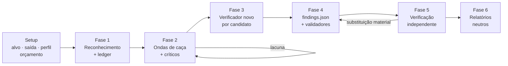

# Auditoria de segurança do código (caça a vulnerabilidades)

Encontrar vulnerabilidades que violam uma **fronteira de confiança real** e entregar ao dono a
evidência no código, a reprodução segura, a prioridade e a menor correção eficaz. É um fluxo
**defensivo e orientado ao código-fonte**: candidato sem principal, recurso ou resultado de
segurança concreto afetado não é achado confirmado.

> **Origem:** adaptada da [security-audit-skill](https://github.com/cloudflare/security-audit-skill)
> da Cloudflare (MIT, ver `LICENSE-cloudflare`). O método, os validadores e o schema são os
> originais; a prosa foi traduzida e ajustada ao padrão do claude-bootstrap.

### Onde ela se encaixa

| Skill | Pergunta que responde | Profundidade |
|---|---|---|
| `pentest` | "O que um pentest externo acharia batendo no contrato da API?" | Rota a rota, Q1–Q8 |
| `auditoria` | "Como está o sistema em todos os eixos (qualidade, auth, banco, deps, segurança)?" | Panorama orquestrado |
| **`auditoria-seguranca`** | "Que fronteira de confiança o **código** deixa atravessar, provado de ponta a ponta?" | Profunda, com ledger e verificação independente |

Na `auditoria`, ela entra como eixo opcional `seguranca-codigo` (IDs `V-xx`).

### Arquivos

| Arquivo | Para quê |
|---|---|
| `fases/1-reconhecimento.md` | Fase 1: prompts de reconhecimento, `arquitetura.md`, seleção de domínios e ledger de cobertura |
| `fases/2-caca.md` | Fase 2: ondas de caça guiadas pelo ledger, contrato do resultado do caçador, críticos de cobertura |
| `fases/3-6-validacao-e-relatorio.md` | Fases 3–6: validação de candidatos, `findings.json`, verificação independente e relatórios |
| `classes/base.md` | Classes de ataque gerais, coringas e "o óbvio" |
| `classes/web-protocolo-e-auth.md` | Framing HTTP, cache, sessão, identidade federada, MFA, API key, mTLS |
| `classes/client-side.md` | DOM, `postMessage`, service worker, vazamento cross-site, UI redress |
| `classes/ia-e-llm.md` | Prompt injection, ferramentas de agente, MCP, saída de modelo |
| `classes/supply-chain-e-release.md` | Dependências, CI, release, assinatura, atualização, plugins |
| `classes/cloud-e-deploy.md` | IAM, IaC, contêiner, serverless, ingress, configuração de runtime |
| `classes/protocolos-rpc-e-mensageria.md` | RPC, serialização, filas, brokers, webhooks, streaming |
| `classes/exaustao-de-recursos.md` | Amplificação, acúmulo, cota, filas e gasto do operador |
| `classes/isolamento-e-ciclo-de-dados.md` | Tenant, cache, busca, exportação, backup, migração, exclusão |
| `classes/desktop-mobile-e-ipc.md` | Deep link, webview, componentes exportados, helpers, IPC local |
| `classes/memoria-e-binario.md` | Memória, inteiros, FFI/ABI, carregamento binário, kernel |
| `referencias/glossario.md` | Termos PT ↔ contrato JSON em inglês (o que **nunca** traduzir) |
| `referencias/procedimento-promocao.md` | Bloco único de promoção de artefatos (copiado literalmente nos prompts) |
| `scripts/report-schema.json` | Schema dos três veredictos de `findings.json` |
| `scripts/validate-findings.cjs` | Validador de `findings.json` (zero dependências) — Fases 4 e 5 |
| `scripts/validate-coverage-ledger.cjs` | Validador de `coverage-ledger.json` (zero dependências) — Fases 1 a 5 |
| `scripts/*.test.cjs` | Testes dos validadores: `node --test scripts/*.test.cjs` |



## Regras antes de começar

As mesmas das skills `pentest` e `auditoria`, somadas às da origem:

1. **Só sistema seu ou do cliente com autorização por escrito.** Se a autorização não estiver
   clara, pare e pergunte antes de qualquer fase.
2. **Leitura do código é read-only.** Nenhum agente altera o código-alvo, dispara ataque contra
   ambiente implantado, gera carga em serviço compartilhado ou muda estado fora do `scratch/`.
3. **Sem sandbox completo, nada de executar código do alvo.** O caminho padrão no Claude Code é
   provar pelo código (`arquivo:linha`) e, quando o fato decisivo depende de execução, registrar
   `needs_validation` com o passo exato para você rodar no seu ambiente descartável.
4. **Nada de segredo na saída:** token truncado (`eyJ...<truncado>`), senha nunca colada, URL
   assinada mascarada, string de conexão sem credencial.
5. **Inventário antes de opinião.** O ledger de cobertura é a declaração de cobertura; resumo de
   subagente sem unidade fechada não conta.
6. **Quem acha não valida.** O agente que confere um candidato nunca é o que o encontrou.

## Modos de operação

Por padrão a skill é **orientação**. Carregá-la não autoriza o fluxo completo nem a criação de
arquivos.

| Modo | Quando | O que faz |
|---|---|---|
| **Orientação** (`orientacao`) | Pergunta de segurança, revisão focada, metodologia, triagem, investigação de um achado específico | Usa só as partes relevantes. **Não** roda as seis fases, não cria diretório de saída, não escreve artefato. Pode lançar agentes focados que devolvem o resultado para a tarefa atual |
| **Auditoria completa** (`completo`, `escopo`) | Pedido explícito de auditar/pentestar o código, revisão "completa", "ponta a ponta", ou pedido de relatório | Roda as seis fases e escreve os arquivos definidos abaixo |

Se o pedido puder significar os dois, faça **uma** pergunta focada antes de criar arquivos ou
começar o fluxo completo.

## Terminologia no Claude Code

| Termo | No Claude Code |
|---|---|
| **Orquestrador** | A sessão principal: coordena a rodada e é dona do estado compartilhado |
| **Ferramenta de delegação** | Ferramenta `Agent` |
| Agente de **pesquisa** (exploração focada, checagem de fato) | `subagent_type: Explore` |
| Agente **geral** (investigação ampla, execução local limitada) | `subagent_type: general-purpose` |

Um `subagent_type:` num título indica qual dos dois papéis roda aquele trabalho. Preserve as
fronteiras de papel, isolamento de escrita, prompt e independência. Lista completa de termos em
`referencias/glossario.md`.

## Segurança universal de execução

Vale nos dois modos. **A inspeção do código é read-only.** Build, teste, processo, browser,
emulador, fuzzer e processamento de fixture controlados pelo alvo só rodam dentro de um sandbox
**imposto pelo sistema operacional** que forneça todos estes controles:

- sem rede externa; só um namespace de loopback isolado quando a conferência precisar de tráfego
  cliente/servidor local;
- ambiente vazio, preenchido a partir de uma allowlist explícita com valores seguros, com `HOME`,
  diretórios temporários e caches locais ao scratch;
- alvo e toolchain somente leitura, com o processo controlado pelo alvo escrevendo só no seu
  `scratch/` designado; e
- limites explícitos e baixos de CPU, memória, processos, tamanho de arquivo, disco e tempo de
  relógio.

O agente, fora do processo controlado pelo alvo, pode fazer uma cópia descartável do código no
`scratch/` designado quando o build precisar escrever ao lado do código. No modo orientação, não
retenha arquivos controlados pelo alvo. Na auditoria completa, só código confiável do lado do
orquestrador pode promover o mínimo resultado não secreto para `artifacts/` retido, com o
procedimento de `referencias/procedimento-promocao.md`. Nunca exponha ao código do alvo um
diretório de saída retido (fora o `scratch/` do próprio agente), o diretório de outro agente, o
home do host, credenciais, sockets ou serviços compartilhados. Não instale dependências nem deixe
o build baixá-las; use só ferramentas e dependências já disponíveis localmente. **Se algum
controle não puder ser imposto, não execute código do alvo:** registre a falta do sandbox como
bloqueio `needs_validation` e dê um plano de validação seguro.

Use principais, fixtures e segredos fictícios. Não sonde endpoints implantados, serviços
externos, infraestrutura compartilhada, identidades de produção, dados de outros usuários nem
planos de controle ao vivo. Não teste disponibilidade contra processo ao vivo ou compartilhado,
não publique artefato, não altere release, não gaste cota de API paga e não vá além do efeito
local mínimo necessário para estabelecer o defeito. Se o fato decisivo está fora do código ou da
fixture em sandbox, registre como precisa de validação.

## Setup da auditoria completa

Na auditoria completa, resolva antes do reconhecimento:

| Item | Regra |
|---|---|
| **Diretório da skill** | Caminho absoluto do diretório que contém este `SKILL.md` (`<skill-dir>`) |
| **Alvo** | Raiz absoluta do repositório revisado |
| **Nome do repo** | Identificador estável a partir do diretório ou do remote Git local |
| **Diretório de saída** | Diretório novo e gravável **fora do alvo**, padrão `~/auditoria-seguranca/<repo>/run-<N>` (`<N>` = próximo inteiro livre). Dentro do alvo só se você escolher explicitamente e o orquestrador confirmar que o controle de versão ignora o diretório inteiro; senão, pare e peça um caminho externo |
| **Ref do código** | Commit revisado e se a worktree está suja. Arquivo gerado ou modificado não revisado não conta como outra revisão |

### Isolamento de escrita

O orquestrador cria e é o **único** que escreve os arquivos compartilhados da rodada:
`run-metadata.json`, `arquitetura.md`, `coverage-ledger.json`, `findings.json`, `RELATORIO.md`,
`ACHADOS-DETALHE.md` e `PRECISA-VALIDACAO.md`.

Cada caçador ou verificador recebe uma raiz única em `<saida>/agents/<agent-id>/`, com `scratch/`
e `artifacts/` separados. IDs canônicos casam com `^[a-z0-9][a-z0-9_-]{0,63}$` e não podem ser
nome de dispositivo do Windows (`con`, `prn`, `aux`, `nul`, `com1`–`com9`, `lpt1`–`lpt9`);
minúsculas evitam colisão por case-fold. O agente e todo processo controlado pelo alvo escrevem
**só** no `scratch/`; o `artifacts/` retido é do orquestrador, nunca é exposto ao sandbox e só é
gravável pelo código confiável de promoção. Agentes não podem mudar arquivo compartilhado, código
do alvo, artefato retido nem o diretório de outro agente. Não use `/tmp` nem o home do host como
fallback gravável.

O procedimento de promoção (descritores retidos, allowlist, limites de bytes e os 11 passos
seguros contra corrida) está em **`referencias/procedimento-promocao.md`**. É a fonte única: as
Fases 2 e 3–6 mandam copiá-lo literalmente nos prompts de caçador e de verificador.

Para uma conferência reproduzida, registre o comando, a entrada exata do teste, os limites do
sandbox e só os nomes de variáveis de ambiente da allowlist mais os valores seguros e não
secretos necessários para reproduzir. Nunca capture nem copie o ambiente do host, variáveis
herdadas, valores de credencial, estado de autenticação ou caminhos não relacionados do host.
Lance a partir de um ambiente vazio em vez de tentar redigir um depois da execução.

Antes de delegar, o orquestrador escreve `run-metadata.json` com, no mínimo, `run_id`, `repo`,
`target`, `source_ref`, `profile`, `scope_paths`, `budget` (null se não houver),
`execution_policy: "sandboxed-source-and-local-only"`, arquivos de domínio selecionados, caminhos
de rodadas anteriores, donos dos arquivos compartilhados e `run_status: "in_progress"`. Atualize o
metadata só quando esses fatos mudarem; o estado dos candidatos fica no ledger e em
`findings.json`.

## Planejamento da auditoria completa

As exigências de cobertura, rodadas anteriores, perfil e orçamento desta seção valem só na
auditoria completa.

### Cobertura e rodadas anteriores

Nenhuma passada é completa. Monte um plano de cobertura determinístico antes de caçar e
atualize-o depois de cada resultado de agente. `fases/1-reconhecimento.md` define as unidades
estáveis de cobertura e `fases/2-caca.md` define as ondas de críticos de cobertura. Só o
orquestrador atualiza o ledger.

Se houver rodadas anteriores, leia todo `coverage-ledger.json` e `findings.json` compatível antes
de planejar a rodada atual:

1. Compare o código atual relevante com cada registro e unidade anterior. Uma ref anterior sozinha
   não prova que o caminho está inalterado.
2. Leve um `confirmed` anterior para o conjunto de candidatos atual só quando o código e as
   condições relevantes estiverem inalterados e a evidência ainda cumprir o contrato atual.
   Ligue-o a uma unidade atual semeada `planned`, preserve o fingerprint, exclua dos caçadores só
   aquela causa raiz carregada e mande o registro pelo caminho atual de verificação final; o
   verificador da Fase 3 que o reconfere vira o dono da atribuição da unidade e a move para
   `candidate`.
3. Quando o código relevante de um `confirmed` anterior mudou, crie uma unidade atual `planned` de
   revalidação. Não ponha esse registro na lista de exclusão dos caçadores. Ele só continua
   confirmado se a validação independente atual estabelecer o caminho e o resultado atuais.
4. Transforme em trabalho atual os `needs_validation`, `deferred`, `blocked`, `out_of_scope`
   anteriores e qualquer unidade com código alterado. Um `needs_validation` ainda externo só pode
   ser carregado depois de conferido o rastro atual no código e ligado por fingerprint a uma
   unidade atual `planned` cuja reconferência pelo verificador forneça dono e evidência; o
   registro mantém o bloqueio não resolvido. Esses estados anteriores nunca suprimem uma unidade
   atual.
5. Uma unidade anterior coberta com o mesmo código pode orientar a prioridade, mas continua
   visível no ledger atual. Um `rejected` anterior suprime só a alegação que falhou e não mudou,
   não a cobertura da unidade; evidência alterada cria trabalho atual.
6. Leia o perfil e o escopo anteriores. Um ledger anterior `quick` ou com escopo contribui só com
   a evidência e as lacunas registradas, nunca com um "o resto está ok" implícito.

Se não houver ledger anterior, diga isso na declaração final de cobertura. **Nunca insinue que uma
rodada esgota o alvo.**

### Perfis e escopo

No setup, escolha o perfil a partir do pedido ou proponha um pelo tamanho e criticidade do alvo.
Registre em `run-metadata.json` (`profile`, `scope_paths`) e informe no relatório. O padrão é
`standard`.

| Perfil | Para quê | Como muda o fluxo |
|---|---|---|
| **`quick`** | Alvo pequeno, re-rodada, primeira olhada rápida | Unidades agrupadas em superfície × fronteira × classe de ataque (o subsistema usa o identificador canônico fixo `profile/quick/all-in-scope-subsystems`); exatamente **uma** onda de caça seguida de exatamente **um** crítico de cobertura final; um verificador novo por candidato serve tanto para a validação do candidato quanto para a verificação final. Sem onda de caça de acompanhamento: descobertas e reatribuições aceitas pelo crítico ficam `deferred` |
| **`standard`** | Padrão | O fluxo como escrito |
| **`deep`** | Alvo crítico ou grande | Unidades divididas por subsistema e modo de ciclo de vida, ondas de críticos até uma passada limpa, validação do candidato e verificação final do registro como agentes novos separados, e segunda passada independente nas unidades `prior_covered_same_source` |

Uma **rodada com escopo** audita um subconjunto: caminhos nomeados, um subsistema, um domínio ou o
diff entre duas refs. Semeie unidades só para superfícies no escopo e registre todo o resto como
`out_of_scope` — **nunca** como `covered`. Uma rodada com escopo ou `quick` deve se apresentar
como cobertura parcial.

O perfil muda amplitude e redundância, **nunca a régua de evidência**. Não corte o portão de
candidato, a fronteira de execução código/local, a disciplina de `needs_validation`, a validação
por schema nem a verificação independente dos `confirmed`.

#### Orçamento

O ledger torna o gasto contável: uma unidade ≈ uma atribuição de caçador; um candidato
sobrevivente = uma ou duas atribuições de verificador, conforme o perfil. Quando você define um
orçamento — ou o orquestrador propõe um para alvo grande — registre `budget` em
`run-metadata.json` como o número máximo de invocações de agente somando todas as fases.

Aplique o portão estrito de orçamento **antes** de lançar qualquer agente de reconhecimento.
Reserve as quatro chamadas base de reconhecimento, um crítico final pós-onda no `quick` ou um
crítico pós-onda mais um crítico final de limpeza distinto no `standard`/`deep`, e pelo menos uma
chamada de verificador. Acrescente reconhecimento focado só depois de repetir esse portão para
cada chamada extra. Se o orçamento pedido não cobrir esse mínimo, não lance nenhum agente: peça
orçamento maior, escopo menor ou outro perfil. Se o pedido continuar igual, registre
`run_status: "incomplete"` com `incomplete_reason: "budget_cannot_fund_reconnaissance_and_reserves"`
e informe que nenhuma passada de auditoria rodou.

Gaste nesta ordem:

1. Conte reconhecimento, todo crítico pós-onda e o crítico final de limpeza separado como invocações
   de agente.
2. **Reserve críticos e validação antes de caçar.** No `quick`, reserve seu único crítico final
   pós-onda. Antes de toda onda de caça `standard` ou `deep`, reserve um crítico pós-onda imediato
   mais um crítico final de limpeza distinto. Reserve também o custo de verificador pelo perfil (cerca
   de 1 ou 2 agentes por candidato esperado; na dúvida, 30% do saldo depois da reserva de
   críticos). Nunca atribua caçadores dentro de nenhuma das reservas.
3. Atribua caçadores às unidades em ordem de prioridade até esgotar a verba de caça. Gaste o
   crítico pós-onda reservado logo depois daquela onda; mantenha intactas as reservas de
   final-limpo e de validação.
4. Antes de uma onda posterior, reserve de novo o crítico pós-onda dela. Se o saldo não cobrir os
   críticos obrigatórios e a reserva de validação, não lance caçadores dessa onda, marque as
   unidades planejadas como `deferred` com motivo `budget_cannot_reserve_critics_and_validation`
   e use o crítico final de limpeza retido para registrar a lacuna resultante.

Antes da onda 1, atualize a estimativa pré-reconhecimento com as unidades semeadas, a contagem de
caçadores implicada, as chamadas obrigatórias de crítico, a reserva de validação e se o saldo
cobre o plano. Se claramente não cobrir, diga e proponha escopo mais estreito ou perfil mais
grosso, em vez de afinar a evidência em silêncio. Se fatos posteriores consumirem a reserva do
crítico final, não lance caçadores, marque todo trabalho planejado como deferred, registre a rodada
como incompleta com motivo `critic_budget_exhausted` e não alegue cobertura completa.

Um orçamento estrito de agentes ainda pode estourar com um conjunto de candidatos inesperadamente
grande ou com uma substituição material na Fase 5 que precise de outro verificador independente.
Se o saldo não validar todos os candidatos, pare de caçar, valide os candidatos em ordem de
fingerprint enquanto o orçamento permitir e registre `run_status: "incomplete"` com
`incomplete_reason: "validation_budget_exhausted"`. Mantenha cada fingerprint não validado ligado
a uma unidade `candidate` com esse motivo não resolvido. Não ponha candidato não validado em
`findings.json`, não o rebatize como `needs_validation` e não reporte a rodada como completa. A
Fase 6 só pode produzir relatório parcial se a primeira seção disser que a validação de
candidatos está incompleta e listar os fingerprints e unidades afetados. **Nunca estoure em
silêncio um orçamento estrito definido por você.**

## Princípios centrais

### Exigir fronteira e resultado

Para todo candidato, nomeie: o principal de menor confiança, a entrada ou ação aceita, o controle
pretendido, a fronteira atravessada, o principal ou recurso afetado e o resultado concreto
observado (ou observável pelo dono). Não eleve a achado de segurança uma boa prática ausente, um
comportamento de deploy adivinhado, um crash genérico de parser ou um auto-impacto.

### Usar evidência local e limitada

A análise estática estabelece o caminho no código. Testes locais em sandbox resolvem o
comportamento quando todos os controles de execução estão disponíveis: um harness mínimo de
função, um teste unitário existente, uma fixture pequena de parser, um teste de integração com
tenant fictício, uma configuração renderizada localmente ou um cliente limitado em loopback
isolado. Pare no valor de retorno errado, no registro fictício não autorizado, no achado do
sanitizer, na diferença de política ou em outro efeito mínimo. Não estenda a conferência local
além do resultado mínimo na fronteira nem produza material de persistência, pós-falha ou
ocultação.

### Respeitar o que o código mostra

Controles de deploy, comportamento de proxy, configuração de provedor, headers do browser,
política de identidade, ACLs de broker, empacotamento e topologia são controles reais. Se são
necessários e não estão no repositório, não presuma nem presença nem ausência. Use
`needs_validation` com o fato exato que falta e um plano seguro, observado pelo dono ou local.

### Separar prioridade de certeza

Só registros `confirmed` recebem severidade. Probabilidade e impacto devem refletir as condições e
o resultado demonstrados; a severidade geral não pode passar do impacto demonstrado.
`needs_validation` significa que uma hipótese específica de fronteira, ancorada no código, está
bloqueada — não é uma vulnerabilidade confirmada de baixa confiança — e **não tem severidade**.

| No JSON | No relatório | Âncora |
|---|---|---|
| `critical` | **Crítico** | Ator não autenticado ganha execução de código, acesso total ao armazenamento de dados ou tomada de contas arbitrárias |
| `high` | **Alto** | Ator derrota totalmente um controle de segurança explícito com consequência real: bypass de autenticação, leitura ou escrita cross-tenant, script armazenado executando para outros usuários, execução de código autenticada, ou parada remota não autenticada de serviço compartilhado |
| `medium` | **Médio** | Violação real de fronteira com raio limitado, pré-condições incomuns ou consequências restritas a um conjunto estreito de recursos |
| `low` | **Baixo** | Exposição de detalhe interno não secreto, ou efeito que exige esforço contínuo para ganho mínimo |
| `informational` | **Informativo** | Observação confirmada de impacto mínimo, útil principalmente como pré-requisito dentro de um achado maior |

O discriminador alto/médio: o resultado demonstrado **derrota totalmente** um controle explícito
para uma ação com consequência real, ou só o **enfraquece**? Se você não consegue dizer o dano
concreto, a severidade é menor do que parece.

### Recomendar a menor correção eficaz no código

Para cada achado confirmado, identifique o invariante que o código deve impor e a mudança mais
estreita que o impõe no último ponto de decisão confiável. Prefira mudanças específicas, com
caminho relativo ao repositório, e testes de regressão a conselhos genéricos de hardening. A
auditoria **descreve** correções; ela não altera o código do alvo. Ao propor, confira que o
conserto não abre outra porta (bloqueio por conta mal desenhado vira negação de serviço).

## Fluxo da auditoria completa

Na auditoria completa, siga as seis fases em ordem:

| Fase | O que faz | Arquivo |
|---|---|---|
| **1. Reconhecimento** | Mapeia o código, fronteiras de confiança, caminhos de build local, domínios selecionados, evidência anterior e o ledger de cobertura inicial determinístico | `fases/1-reconhecimento.md` |
| **2. Ondas de caça guiadas por cobertura** | Atribui caçadores isolados a partir do ledger e coleta resultados estruturados de candidatos | `fases/2-caca.md`, `classes/base.md` e os domínios selecionados |
| **3. Validação de candidatos** | Consolida fingerprints e entrega cada candidato a um verificador novo | `fases/3-6-validacao-e-relatorio.md` |
| **4. Saída estruturada** | Escreve todos os registros finais `confirmed`, `needs_validation` e `rejected` em `findings.json`; valida com `scripts/report-schema.json` e `scripts/validate-findings.cjs`, e valida a alegação de cobertura com `scripts/validate-coverage-ledger.cjs` | idem |
| **5. Verificação independente dos registros** | Agentes novos verificam as alegações finais no código e reconciliam correções ou mudanças de estado | idem |
| **6. Relatório neutro** | Deriva `RELATORIO.md`, `ACHADOS-DETALHE.md` e `PRECISA-VALIDACAO.md` dos registros finais, sem instrução de sonda ao vivo | idem |

```bash
# validadores (zero dependências, Node 18+)
node <skill-dir>/scripts/validate-coverage-ledger.cjs <saida>/coverage-ledger.json
node <skill-dir>/scripts/validate-findings.cjs <saida>/findings.json
```

Não encerre a rodada antes de um dos **dois** estados terminais: (a) todos os artefatos da Fase 6
escritos e os dois validadores passando, ou (b) `run_status: "incomplete"` registrado com o motivo
exato e a lacuna declarada no relatório. Nunca pare no meio de uma fase.

## Antipadrões

1. Desvio de checklist apresentado como vulnerabilidade.
2. Conselho de defesa em profundidade sem violação de fronteira alcançável.
3. Teste ao vivo ou em ambiente compartilhado onde a evidência local limitada não basta.
4. Adivinhar comportamento de provedor, proxy, browser, identidade ou deploy que não está no código.
5. Tratar autoridade pretendida do mesmo principal ou auto-impacto como resultado entre fronteiras.
6. Reportar efeito de parser ou runtime mais forte do que o observado.
7. Emitir resultado de caçador só em prosa, que não pode ser deduplicado nem verificado.
8. Re-reportar `confirmed` anterior carregado com o mesmo código, ou usá-lo como exemplo que
   ancora a caça.
9. Dar severidade a registro `needs_validation`.
10. Escrever o relatório antes da verificação independente, ou deixar prosa e JSON discordarem.
