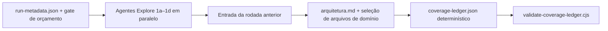

# Reconhecimento



### Fase 1: Mapear o código-fonte e planejar a cobertura

O orquestrador inicializa o `run-metadata.json`, aplica o gate estrito de orçamento pré-reconhecimento do `SKILL.md` e, em seguida, cria as raízes de scratch dos agentes e o ledger compartilhado antes da caça. Se o gate falhar, registre o status incompleto nos metadados e não lance nenhum agente de reconhecimento. O reconhecimento lê apenas o alvo e o estado de build/configuração disponível localmente. Ele não contata endpoints implantados, provedores de identidade externos, registries, brokers, APIs de nuvem nem outros serviços compartilhados.

Lance vários agentes `Explore` em paralelo. Eles devolvem fatos estruturados ao orquestrador e não escrevem arquivos.

**Agente 1a: Produto, stack e operação local**

```text
Leia o alvo em <target>. Não use acesso à rede. Devolva:
1. Tipo de produto, usuários, operadores e ações comuns sensíveis à confiança.
2. Linguagens, frameworks, sistema de build, runtimes e modelos de deploy visíveis localmente.
3. Pontos de entrada relativos ao repositório e fronteiras entre subsistemas.
4. Comandos exatos de build e teste que poderiam rodar offline com dependências locais, os locais onde se espera que escrevam e as entradas controladas pelo alvo que processam. Não os execute durante o reconhecimento.
5. Software ou protocolo comparável visível na documentação e nas dependências locais. Se nenhuma comparação útil tiver base no código-fonte, diga isso.
6. Toolchains locais ausentes ou fatos de runtime que limitem a execução controlada.
Devolva apenas fatos do código-fonte com referências arquivo:linha relativas ao repositório.
```

**Agente 1b: Principais, autoridade e controles**

```text
Leia todo o código-fonte que estabelece identidade, autorização, isolamento e privilégio. Mapeie:
1. Cada principal de menor confiança e as ações que ele tem por design.
2. Autenticação ou identidade do par em cada superfície de entrada.
3. Autorização por recurso e escopo de tenant/dono.
4. Autoridade de processo, navegador, workload, CI, plugin, modelo/ferramenta, dispositivo ou IPC local.
5. Mudanças de privilégio, confirmação, revogação, recuperação e caminhos de fallback.
6. Quais controles são visíveis no código-fonte e quais dependem de um fato de deploy não observado.
Devolva as fronteiras de confiança e a localização dos controles com referências arquivo:linha relativas ao repositório. Não infira alcançabilidade em produção.
```

**Agente 1c: Superfícies de entrada, cópias e sinks**

```text
Inventarie todo lugar visível no código-fonte por onde entra entrada externa ou de menor confiança:
- HTTP/navegador, RPC/mensagem/protocolo, arquivos/compactados/documentos, CLI/env/config, plugins/dependências/CI, eventos de nuvem/seletores de IAM, contexto de modelo/argumentos de ferramenta, mobile/deep-link/webview e IPC local.
Para cada superfície, siga as principais transformações, as cópias armazenadas ou derivadas e os sinks relevantes para segurança. Registre os limites visíveis no código-fonte e os caminhos paralelos que levam ao mesmo efeito.
Devolva caminhos relativos ao repositório e números de linha. Seja completo, mas não execute nada nem envie entradas.
```

**Agente 1d: Execução local e visibilidade do deploy**

```text
Leia testes, definições de build, manifestos, empacotamento e overlays de ambiente mantidos. Devolva:
1. Testes offline pequenos ou fixtures existentes que poderiam validar fronteiras de confiança com dados fictícios dentro do sandbox obrigatório imposto pelo sistema operacional.
2. Processos que poderiam usar um namespace de rede loopback isolado, sem dependências externas ou compartilhadas.
3. Comandos que baixariam dependências, publicariam artefatos, contatariam APIs pagas/de provedor ou afetariam estado compartilhado; marque-os como proibidos nesta rodada.
4. Controles e anexos implantados que o código-fonte não consegue estabelecer e que, portanto, exigem needs_validation se forem decisivos.
5. O caminho final ativo do código-fonte para cada modo de deploy, só onde o repositório o seleciona de forma determinística.
6. Se a plataforma local consegue impor ambiente vazio com allowlist, nenhuma rede externa, montagens somente leitura do alvo/toolchain, escrita apenas no scratch e limites explícitos de CPU, memória, processos, tamanho de arquivo, disco e tempo de relógio. A falta de qualquer controle bloqueia a execução controlada pelo alvo.
7. Se código confiável do lado do orquestrador consegue promover arquivos de scratch pré-declarados com travessia por descritor confinada ao caminho e sem seguir links, conferências não bloqueantes de arquivo regular, travessia sem seguir links de todo diretório pai do destino, criação exclusiva do arquivo regular de destino e limites explícitos de tamanho por arquivo e acumulado. A falta de controles de promoção bloqueia o uso de arquivos de scratch como evidência.
```

Acrescente agentes de reconhecimento focados para modos de deploy ou subsistemas materialmente distintos que esses quatro não mapeiam. Não os omita em silêncio: se o gate de orçamento do `SKILL.md` bloquear um agente focado, não lance nada para ele, semeie a área não mapeada como uma unidade `deferred` no ledger com o motivo `budget_cannot_reserve_critics_and_validation` e declare a lacuna no relatório.

## Entrada da rodada anterior

Antes de selecionar o trabalho, o orquestrador lê todo `coverage-ledger.json` e `findings.json` anterior disponível para o mesmo repositório:

- Compare as localizações no código-fonte, os controles, as condições e a identidade derivada do código-fonte de todo registro e toda unidade anteriores com o código-fonte atual.
- Leve um registro `confirmed` anterior inalterado para o conjunto atual de candidatos, com o mesmo fingerprint, só quando o código-fonte relevante, as condições e a evidência que o qualifica ainda se aplicarem. Vincule-o a uma unidade atual `planned` com `prior_status: "prior_confirmed_same_source"` e coloque apenas essa causa raiz na lista de exclusão dos caçadores. O verificador da Fase 3 que reverifica o registro levado adiante passa a ser o dono da atribuição dessa unidade; a reconferência do código-fonte feita por ele é a primeira checagem da unidade e move a unidade para `candidate` com o fingerprint levado adiante.
- Crie uma unidade atual `planned` de revalidação `prior_confirmed_changed_source` quando qualquer código-fonte ou condição relevante tiver mudado. Não exclua essa causa raiz da caça nem presuma que o veredito anterior ainda vale.
- Crie unidades de trabalho atuais para toda unidade anterior `needs_validation`, `deferred`, `blocked`, `out_of_scope` e de código-fonte alterado. Esses estados são entrada prioritária, nunca chaves de deduplicação ou supressão.
- Leve adiante um registro `needs_validation` anterior ainda bloqueado, com o mesmo fingerprint, só depois que o código-fonte atual sustentar o seu trace. Vincule-o a uma unidade atual `planned` com `prior_status: "prior_needs_validation"`; o registro mantém o bloqueio não resolvido. O verificador da Fase 3 que reconfere o registro levado adiante passa a ser o dono da atribuição dessa unidade; a reconferência feita por ele é a primeira checagem da unidade e move a unidade para `candidate` com o fingerprint levado adiante. Inclua o registro na verificação final.
- Trate registros `rejected` anteriores como alegações obsoletas, a menos que a evidência atual mude o trace que falhou ou a condição ausente. Uma rejeição inalterada suprime só aquela alegação exata, não a revisão da unidade de cobertura.
- Registre ledgers ausentes ou incompatíveis em vez de tratá-los como cobertura vazia.

Declare no `run-metadata.json` os caminhos e as referências de código-fonte usados. Resuma em `arquitetura.md` apenas as consequências para a cobertura.

## Resumo de arquitetura e seleção de arquivos de domínio

O orquestrador sintetiza `<output-dir>/arquitetura.md`, com limite rígido de cerca de 1.000 palavras. Inclua:

1. Produto, principais, autoridade normal e recursos protegidos.
2. A linha de base de software comparável do Agente 1a, quando tiver base no código-fonte: quais trade-offs de segurança o comparável aceita. Use-a para calibrar esforço e severidade, nunca para descartar um achado demonstrado; se o comparável compartilha um padrão de defeito que já importou na prática, isso fortalece o achado. Omita esta linha quando não houver comparável significativo.
3. Stack técnica, caminhos de deploy visíveis no código-fonte e limites de build/teste offline.
4. Superfícies de entrada e os caminhos importantes de fonte até sink ou de ciclo de vida.
5. Fronteiras de confiança e o controle visível no código-fonte mais forte em cada uma.
6. Caminhos iniciais relativos ao repositório.
7. Lacunas de cobertura anteriores, alvos de revalidação por código-fonte alterado e bloqueados, e exclusões de confirmados com o mesmo código-fonte.
8. Um resumo curto da seleção de arquivos de domínio derivado de [classes/base.md](../classes/base.md): arquivos selecionados e as fronteiras visíveis no código-fonte que os exigem.

Mantenha o bloco comum da atribuição, os blocos de domínio selecionados e os blocos excluídos com seus motivos em cada unidade do ledger, não em `arquitetura.md`. Isso mantém o limite da arquitetura válido em rodadas grandes e torna verificável por máquina o mapa exato do prompt do caçador.

Não selecione um arquivo de domínio só porque o nome da linguagem ou da dependência aparece. Selecione-o porque o reconhecimento encontrou a fronteira sensível à confiança descrita na sua seção `Quando usar este arquivo`. Não exclua uma fronteira visível só porque outro agente vai revisar uma classe relacionada.

## Ledger de cobertura determinístico

O orquestrador escreve `<output-dir>/coverage-ledger.json` como um array JSON de nível superior. Derive uma unidade para cada combinação material de superfície de entrada, fronteira de confiança, subsistema e classe de ataque comum ou de domínio aplicável, na granularidade que o perfil da rodada define (`quick` usa uma única identidade de subsistema que abrange tudo no escopo; `deep` acrescenta modos de ciclo de vida). Numa rodada com escopo, semeie as superfícies dentro do escopo para atribuição e mantenha as superfícies excluídas descobertas como unidades `out_of_scope`, para que rodadas completas posteriores possam transformá-las em trabalho atual.

Cada dimensão tem um rótulo humano e um valor estável derivado do código-fonte em `canonical_refs`. Use a mesma referência canônica para o mesmo objeto do código-fonte entre rodadas, mesmo que o rótulo de exibição mude. Referências adequadas incluem um caminho de entrada relativo ao repositório mais o escopo exportado, uma identidade de rota ou mensagem definida no código-fonte, o controle do código-fonte que define uma fronteira, um caminho de pacote do repositório e a referência exata do bloco de classe de ataque. Uma referência de bloco é `<caminho relativo à skill>#<nome exato>`: o caminho do arquivo relativo à raiz da skill, `#`, e o nome exato da classe como está escrito em negrito ou como título naquele arquivo — por exemplo `classes/base.md#Controle de acesso` ou `classes/web-protocolo-e-auth.md#Envenenamento de cache web por entrada fora da chave`. É um identificador estável comparado com o texto do arquivo, não uma âncora HTML renderizada. Para blocos de seção dos arquivos de domínio, use o texto do título antes de qualquer qualificador entre parênteses (por exemplo `Disciplina central`). Não derive referências passando rótulos de exibição para minúsculas nem gerando slug.

Derive o `coverage_id` sem slugs com perda:

1. Exija que toda referência esteja em Unicode NFC com valores escalares válidos, conteúdo visível, nenhum code point de controle, de formatação, separador de linha/parágrafo ou ignorável por padrão, e sem espaços em volta.
2. Codifique seus bytes UTF-8 com percent-encoding da RFC 3986: deixe sem escape apenas `A-Z a-z 0-9 - . _ ~` e use `%HH` em maiúsculas para todo outro byte.
3. Junte as referências codificadas de `surface`, `boundary`, `subsystem` e `attack_class` com `::`; acrescente `lifecycle` codificado quando existir.

Use o valor canônico fixo `profile/quick/all-in-scope-subsystems` para a dimensão de subsistema agregada do perfil quick. Não inclua número de onda, agente, veredito, severidade ou número de linha numa referência ou ID. Ordene as unidades lexicograficamente por `coverage_id` antes de cada atribuição. Falhe em todo ID duplicado. Se IDs duplicados tiverem campos semânticos diferentes, trate isso como colisão de identidade canônica; nunca os mescle nem os sobrescreva em silêncio. O validador também rejeita uma mesma tupla semântica representada por referências canônicas diferentes.

Cada unidade registra:

```json
{
  "coverage_id": "...",
  "canonical_refs": {
    "surface": "src/router.ts#POST /users/:id",
    "boundary": "src/authz.ts#requireOwner",
    "subsystem": "packages/api",
    "attack_class": "classes/base.md#Controle de acesso"
  },
  "surface": "...",
  "boundary": "...",
  "subsystem": "...",
  "attack_class": "...",
  "starting_paths": ["repo/relative/path"],
  "ordinary_attack_class_block": "classes/base.md#Controle de acesso",
  "selected_companion_blocks": ["classes/FILE.md#section"],
  "excluded_blocks": [{"block": "classes/FILE.md#section", "reason": "..."}],
  "prior_status": "new|prior_confirmed_same_source|prior_confirmed_changed_source|prior_needs_validation|prior_deferred|prior_blocked|prior_out_of_scope|prior_covered_same_source|prior_covered_changed_source|prior_rejected_claim_changed|none",
  "attempts": [],
  "wave": 1,
  "status": "planned",
  "agent_id": null,
  "reviewed_paths": [],
  "local_checks": [],
  "result_fingerprints": [],
  "unresolved": []
}
```

Quando o `lifecycle` for material, acrescente tanto `canonical_refs.lifecycle` quanto um campo humano `lifecycle`. `ordinary_attack_class_block` só é null quando nenhum bloco comum se aplica. A lista de blocos de domínio selecionados inclui cada classe aplicável mais a `Disciplina central`, os `Movimentos universais` e as `Regras de validação` do seu arquivo de domínio; `excluded_blocks` registra todo bloco considerado mas não selecionado e o fato do código-fonte que o exclui.

O orquestrador pode acrescentar campos de controle interno, mas mantém estáveis os campos semânticos acima. Em `prior_status`, `new` marca uma superfície vista pela primeira vez nesta rodada quando existem ledgers anteriores compatíveis; `none` marca uma unidade semeada quando não há ledger anterior compatível disponível. Unidades anteriores `deferred`, `blocked`, `out_of_scope` e de código-fonte alterado são inicializadas como trabalho atual `planned` quando agora estiverem no escopo. Uma unidade anterior coberta com o mesmo código-fonte continua visível no ledger atual; atribua primeiro o código-fonte alterado, os caminhos de ciclo de vida importantes e os conflitos exatos, e depois use o crítico de cobertura para decidir se ela precisa de outra passada.

`attempts` é um arquivo somente de acréscimo para atribuições com evidência que um crítico de cobertura reabre. Antes da reatribuição, acrescente exatamente os campos `wave`, `status`, `agent_id`, `reviewed_paths`, `local_checks`, `result_fingerprints` e `unresolved` anteriores da unidade, mais o `reassignment_reason` do crítico, baseado no código-fonte. Só os estados `blocked`, `covered` e `candidate` podem ser arquivados. As tentativas arquivadas mantêm os mesmos invariantes de estado e evidência das unidades vivas, usam ondas estritamente crescentes abaixo da onda atual e mantêm os donos e artefatos que as produziram. A próxima atribuição incrementa `wave`, usa um dono novo e começa com a evidência viva vazia. Se o perfil ou o orçamento impedir outra atribuição, incremente `wave` e use o estado vivo `deferred` com dono null, evidência vazia e o motivo da parada. Nunca copie as checagens ou os artefatos de um dono arquivado para o estado vivo. Um estado terminal vivo posterior contém apenas a evidência da nova tentativa; o arquivo permanece inalterado.

Aplique esta tabela de estados exatamente:

| Status | `agent_id` da unidade | `reviewed_paths` / `local_checks` | `result_fingerprints` | `unresolved` |
|---|---|---|---|---|
| `planned` | null | vazios | vazio | vazio |
| `not_applicable`, `out_of_scope`, `deferred` | null | vazios | vazio | motivo não vazio |
| `in_progress` | dono canônico | vazios | vazio | vazio |
| `blocked` | dono canônico | ambos não vazios, com evidência parcial própria | vazio | bloqueio não vazio |
| `covered` | dono canônico | ambos não vazios | vazio | vazio |
| `candidate` | dono canônico | ambos não vazios | não vazio | opcional |

IDs canônicos de agente casam com `^[a-z0-9][a-z0-9_-]{0,63}$` e não são nomes de dispositivo do Windows. Minúsculas são obrigatórias, para que um mesmo ledger não contenha aliases que diferem só por caixa. O `agent_id` da unidade registra o dono da atribuição. Toda checagem registra o seu próprio `agent_id` e `reviewed_paths` não vazio; o `reviewed_paths` no nível da unidade é exatamente a união deles. Uma checagem só de código-fonte usa `artifact: null`. Uma checagem local exige um arquivo regular promovido apenas por código confiável do lado do orquestrador para exatamente `agents/<check.agent_id>/artifacts/`. Isso permite que checagens de caçador e de verificador coexistam numa mesma unidade. Caminhos de scratch, arquivos na raiz de saída, symlinks, arquivos especiais e artefatos de outro dono de checagem não são evidência.

O ledger é a alegação de cobertura. Um resumo de arquitetura, uma contagem de agentes ou uma frase genérica do tipo "auth revisado" não é evidência de cobertura. A Fase 2 fecha unidades apenas a partir dos caminhos e das checagens no resultado estruturado de um caçador.

Rode `node <skill-dir>/scripts/validate-coverage-ledger.cjs <output-dir>/coverage-ledger.json` depois de semear, depois de toda atualização do orquestrador e antes da Fase 6. O validador rejeita entrada acima de 5 MiB, 64 níveis de aninhamento, 10.000 unidades, 1.000 entradas numa coleção aninhada ou 500.000 valores percorridos, e limita a 100 os erros de validação reportados. Na prática, o limite de 5 MiB comporta cerca de 2.000–5.000 unidades realistas, então ele é atingido antes do limite de 10.000 unidades. Corrija todo erro antes de atribuir trabalho ou fazer uma alegação de cobertura.
