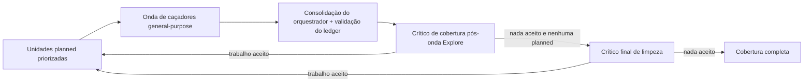

# Caça de vulnerabilidades



### Fase 2: Rodar ondas de caça guiadas por cobertura

O orquestrador atribui unidades `planned` do ledger a agentes `general-purpose`. Use caçadores focados suficientes para cobrir as unidades sem combinar fronteiras não relacionadas. Um caçador pode ser dono de unidades intimamente relacionadas num mesmo subsistema; nenhuma unidade pode ficar sem atribuição em silêncio por causa de um limite de quantidade de agentes — uma unidade que o orçamento não alcança fica explicitamente `deferred` com o motivo `budget_cannot_reserve_critics_and_validation`.

Quando um orçamento ou perfil limita a quantidade de caçadores, atribua as unidades em ordem de prioridade e registre no ledger a justificativa da ordem. Classifique por: (1) superfícies de entrada não autenticadas ou de menor confiança antes das autenticadas; (2) fronteiras que protegem os recursos mais valiosos (credenciais, dados entre tenants, execução de código, autoridade de release); (3) lacunas de rodadas anteriores, alvos de revalidação e código-fonte alterado antes de re-passadas no mesmo código-fonte; (4) unidades cuja classe historicamente rende achados confirmados para este tipo de alvo antes das especulativas. Empates são desfeitos lexicograficamente por `coverage_id`, para que as rodadas continuem determinísticas.

Antes do lançamento, o orquestrador muda as unidades atribuídas para `in_progress`, define um `agent_id` canônico em minúsculas e cria o `scratch/` desse agente e o `artifacts/` de propriedade do orquestrador. Caçadores leem o código-fonte e o contexto fornecido pelo orquestrador, escrevem apenas no seu `scratch/` exclusivo e devolvem um único resultado estruturado pela ferramenta Agent. Eles nunca escrevem artefatos retidos nem editam o código-fonte do alvo, `arquitetura.md`, `coverage-ledger.json`, `findings.json` ou arquivos de outro agente.

## Prompt obrigatório do caçador

Todo prompt de caçador contém estas partes, nesta ordem:

1. Um preâmbulo de papel com duas frases: o objetivo do caçador é encontrar falhas de invariantes de segurança com base no código-fonte nas unidades atribuídas a ele, e ele deve devolver exatamente um objeto JSON que corresponda ao contrato de resultado estruturado no fim deste prompt.
2. O `arquitetura.md` na íntegra.
3. Os coverage IDs atribuídos, o subsistema, a fronteira, os caminhos iniciais relativos ao repositório e o mapa de blocos da atribuição de cada unidade, vindo do `coverage-ledger.json`.
4. Os blocos selecionados exatos, copiados na íntegra: cada bloco de classe de ataque comum selecionado de `classes/base.md` e, de cada arquivo de domínio selecionado, a sua `Disciplina central`, cada subseção de classe de ataque escolhida, os `Movimentos universais` e as `Regras de validação`. Blocos comuns são autocontidos e não trazem seções no estilo dos arquivos de domínio de `Disciplina central`, `Movimentos universais` ou `Regras de validação`. Não envie apenas nomes de blocos ou de arquivos de domínio.
5. Os blocos comuns e de domínio excluídos, explicitamente, com um motivo para cada exclusão.
6. O método central de caça abaixo, seguido do bloco do procedimento de promoção.
7. As regras centrais de validação abaixo.
8. As exclusões de confirmados anteriores com o mesmo código-fonte levadas adiante, cada uma limitada a fingerprint, título e causa raiz, mais os coverage IDs atuais de outros donos que este caçador não deve duplicar.
9. Os caminhos exclusivos de scratch/artifacts, o ID de agente seguro, a allowlist de promoção pré-declarada e os limites de bytes, e o contrato de resultado estruturado, incluindo o bloco de Resultado estruturado do caçador abaixo e os ramos `confirmed` e `needs_validation` do `scripts/report-schema.json` copiados na íntegra.

Um prompt pode selecionar vários blocos de domínio quando o mesmo caminho atravessa vários domínios. Mantenha as restrições deles juntas. O escopo é a obrigação de cobertura do caçador, não permissão para duplicar trabalho excluído. Se surgir uma fronteira diferente inesperada, devolva-a em `uncovered` para que o orquestrador crie uma unidade estável no ledger e a atribua na próxima onda.

#### Método central de caça — incluir em todo prompt de caçador

```text
## Método defensivo de busca de vulnerabilidades

Seu objetivo é encontrar falhas de invariantes de segurança com base no código-fonte e a
menor correção, não ampliar o dano além do resultado na fronteira. Fique dentro da revisão
de código-fonte e da execução local controlada.
Não contate endpoints implantados, APIs de provedores, registries, sistemas de identidade,
brokers de mensagens, serviços compartilhados nem outros usuários. Use apenas dados
fictícios locais.

LEIA O CÓDIGO EM PROFUNDIDADE. Siga cada entrada atribuída através de parsing, identidade,
autorização, normalização, estado, cópias derivadas e o sink final. Leia os caminhos
irmãos, legados, em lote, de retry, de cancelamento, de migração e de erro que produzem o
mesmo efeito. Compare controles irmãos quanto a equivalência, não só presença, e compare o
que um componente garante com o que o componente seguinte presume.

TRABALHE A PARTIR DE UM INVARIANTE CONCRETO:
1. Nomeie o principal de menor confiança e a capacidade inicial.
2. Nomeie o valor, a ação, a transição de estado ou o seletor de recurso aceito.
3. Localize o controle que deveria rejeitá-lo, vinculá-lo, isolá-lo, limitá-lo ou revogá-lo.
4. Rastreie o caminho exato no código-fonte depois dessa decisão.
5. Pare no menor registro fictício afetado, valor de retorno errado, efeito na integridade
   do processo ou efeito observável localmente num recurso compartilhado.
6. Declare uma mudança no código-fonte e um caso de regressão que imponham o invariante.

LIMITE DE PROFUNDIDADE: rastreie apenas caminhos que possam alcançar a fronteira atribuída a
você ou cujas garantias essa fronteira usa. Encerre uma linha de investigação assim que o
invariante estiver resolvido, para um lado ou para o outro, e registre o resultado na sua
saída estruturada — uma disposição covered, candidate ou blocked, ou uma entrada em
`uncovered` — em vez de continuar procurando.

TESTE CAMINHOS TRISTES E DIVERGÊNCIAS. Verifique estado ausente, vazio, zero, negativo,
máximo, acima do limite, duplicado, com codificação mista, obsoleto, revogado, reordenado,
concorrente, parcialmente migrado, com dependência falha e de rollback, só onde a interface
os aceita. Compare canonicalização e unidades em toda passagem entre parser e política.
Em problemas de várias etapas, trate cada saída como pré-requisito e não presuma uma
fronteira posterior. Se algum pré-requisito não estiver estabelecido, registre um bloqueio.

Quando um candidato proposto high ou critical revelar uma causa raiz reutilizável, procure
variantes léxicas, estruturais e lógicas nos caminhos dos coverage IDs atribuídos a você.
Consolide a mesma causa raiz, mas estabeleça as condições e o impacto de cada variante de
forma independente. Não investigue unidades de outros donos. Devolva como `uncovered` uma
variante que não tenha unidade de cobertura atual.

USE A CHECAGEM LOCAL MAIS ESTREITA QUE RESOLVA A ALEGAÇÃO. Builds, testes, processos,
navegadores, emuladores, fuzzers e processamento de fixtures controlados pelo alvo só
podem rodar dentro do sandbox imposto pelo sistema operacional e aprovado pelo
orquestrador. Ele deve desativar a rede externa, começar de um ambiente vazio com
allowlist, expor o alvo e as ferramentas como somente leitura, permitir escrita apenas no
seu diretório de scratch e aplicar limites baixos de CPU, memória, processos, tamanho de
arquivo, disco e tempo de relógio. Loopback isolado só é permitido para uma fixture local.
Se algum controle estiver indisponível, não execute: devolva needs_validation com esse
bloqueio exato. Prefira um teste unitário existente, um harness mínimo de função, uma
chamada de serviço com tenant fictício, uma fixture malformada pequena, um escalonamento
determinístico de corrida ou uma política renderizada localmente.
Não instale nem baixe ferramentas.

Registre a entrada exata, o comando, os limites e o resultado mínimo. Do ambiente, registre
apenas os nomes de variáveis da allowlist e os valores seguros, não secretos, necessários
para reproduzir a checagem. Nunca capture o ambiente do host, variáveis herdadas,
credenciais, estado de autenticação ou caminhos não relacionados do host. O processo
controlado pelo alvo escreve apenas no scratch. Depois que o sandbox e todos os seus
processos terminarem, só código confiável do lado do orquestrador pode promover arquivos
pré-declarados relativos ao scratch, seguindo o bloco do procedimento de promoção incluído
na íntegra neste prompt. Nem você nem o código do alvo escrevem artefatos retidos. Se a
promoção estiver indisponível ou falhar para uma evidência decisiva, devolva
needs_validation com o bloqueio exato da promoção.
Nunca estresse a disponibilidade, acione um alvo em produção, use uma credencial real,
publique um artefato ou continue além do efeito mínimo observado.

Um fato de deploy, navegador, provedor, broker, sistema operacional, proxy, pacote, segredo
ou identidade fora do código-fonte não é prova nem a favor nem contra. Se um fato desses for
decisivo, devolva um registro needs_validation com a observação exata que falta e uma
checagem segura observada pelo dono.
```

#### Procedimento de promoção — copie este procedimento de promoção literalmente em todo prompt de caçador

Fonte única: `referencias/procedimento-promocao.md`.

```text
Procedimento de promoção de artefatos (somente código confiável do lado do orquestrador):
Apenas referência para você: o orquestrador executa estes passos; você nunca os executa.

Antes da execução, o orquestrador abre e retém descritores de diretório confiáveis e
não herdáveis para as raízes scratch/ e artifacts/ do agente, e registra uma allowlist
dos arquivos de artefato esperados (relativos ao scratch) com limites explícitos de
bytes por arquivo e acumulado. Nunca passe esses descritores ao agente nem ao sandbox.
Depois que o sandbox e todos os seus processos terminarem, código confiável do lado do
orquestrador promove cada arquivo da allowlist separadamente:

1. Valide o caminho relativo declarado: rejeite componentes absolutos, vazios, `.`,
   `..` ou que sejam symlink.
2. Percorra cada componente pai a partir do descritor retido da raiz scratch com
   operações relativas a diretório e sem seguir links; nunca reabra por caminho.
3. Abra a folha sem seguir links e em modo não bloqueante.
4. Confirme com `fstat` que é um arquivo regular, com contagem de links exatamente um
   e dentro dos limites de bytes registrados (por arquivo e acumulado).
5. Aplique esses limites de novo durante a leitura desse descritor.
6. Copie exatamente o tamanho verificado, repita o `fstat` e rejeite se a identidade,
   o tipo, a contagem de links ou o tamanho mudarem.
7. No destino, percorra cada componente pai a partir do descritor retido da raiz
   artifacts com operações relativas a diretório e sem seguir links; exija que cada
   componente existente seja um diretório real e crie de forma exclusiva qualquer
   diretório ausente antes de reabri-lo e verificá-lo sem seguir links.
8. Crie a folha de forma exclusiva sem seguir links, confirme que o destino aberto é
   um arquivo regular com contagem de links exatamente um e copie a partir do
   descritor de origem verificado, sem reabrir nenhum dos dois caminhos.
9. Em sistemas não POSIX, use APIs equivalentes e seguras contra corrida.
10. Nunca copie recursivamente nem use glob no scratch, nunca extraia arquivo compactado
    dentro de artifacts e nunca abra ou promova symlink, FIFO, socket, dispositivo,
    diretório, arquivo com hard link, arquivo que esteja mudando ou que exceda o limite.
11. Se alguma conferência estiver indisponível, não puder ser aplicada ou falhar,
    descarte a entrada do scratch; se ela for evidência decisiva, mantenha
    `needs_validation` com o bloqueio exato da promoção.
```

#### Regras centrais de validação — incluir em todo prompt de caçador

```text
## Gate de candidato

1. Um candidato precisa de um trace completo do código-fonte, relativo ao repositório, e de
   evidência da causa raiz alegada, incluindo o controle visível no código-fonte mais forte.
2. Um registro proposto como confirmed precisa de um resultado local observado e controlado,
   impacto significativo através de uma fronteira declarada, condições completas e nenhuma
   camada visível que o impeça.
3. Não transforme um crash em execução de código, trabalho comum em indisponibilidade
   compartilhada, nem uma ação do mesmo principal em ganho de privilégio.
4. Se um fato necessário não for visível no código-fonte nem observável localmente, use
   needs_validation. Nomeie os bloqueios exatos; não dê severidade a ele nem um desfecho
   especulativo.
5. A falta de uma boa prática sem principal/recurso afetado é excluída ou é hardening,
   não um achado. Um candidato refutado pelo código-fonte não é needs_validation.
6. Use o mesmo fingerprint derivado do código-fonte para a mesma causa raiz em todo estado.
   Ele deve casar com `^[A-Za-z0-9][A-Za-z0-9._:/@+-]*$` e não deve incluir linha,
   onda, agente, severidade nem veredito.
7. Devolva um array de candidatos vazio quando nada sobreviver a estes gates.
```

## Limites da validação local

A execução local serve para confirmação, não para ampliar impacto:

| | |
|---|---|
| **Permitido apenas no sandbox obrigatório do sistema operacional** | builds offline com as dependências presentes; processos em loopback isolado usando estado fictício; testes unitários e de integração; processamento de fixtures pequenas; sanitizers; testes de fuzz/regressão limitados; checagens determinísticas de concorrência; testes locais de navegador/emulador com contas fictícias; manifestos renderizados e avaliação de políticas com identidades fictícias; chamadas externas ou pagas mockadas. |
| **Proibido** | tráfego em produção ou para ambientes implantados; requisições a serviços não iniciados para esta checagem isolada; instalação de dependências pela rede; contas ou credenciais reais; dados de produção; filas compartilhadas, recursos de nuvem, runners, registries, serviços de assinatura ou de release; publicação; estresse, saturação ou geração de custo; qualquer trabalho depois do resultado mínimo na fronteira com dados fictícios. |

O sandbox começa com um ambiente vazio, não dá ao código do alvo rede externa nem caminho gravável no host, e impõe limites explícitos e baixos de recursos e de tempo a toda checagem, não só às que se espera que sejam caras. A saída no scratch continua controlada pelo alvo depois do término. Promova-a apenas com o procedimento do host sem seguir links, confinado ao caminho, de arquivo regular e de tamanho limitado descrito em `referencias/procedimento-promocao.md`. A falta de qualquer capacidade de sandbox ou de promoção não apaga um candidato com base no código-fonte; represente o bloqueio exato em `needs_validation`.

## Resultado estruturado do caçador

Devolva exatamente um objeto JSON, sem texto em volta:

```json
{
  "units": [
    {
      "coverage_id": "one assigned ID",
      "disposition": "covered|candidate|blocked",
      "reviewed_paths": ["repo/relative/path"],
      "checks": [
        {
          "agent_id": "canonical owner of this check",
          "reviewed_paths": ["repo/relative/path owned by this check"],
          "invariant": "specific control checked for this unit",
          "method": "source|local",
          "result": "what source or the bounded check established",
          "artifact": "agents/<agent-id>/artifacts/file for local, null for source"
        }
      ],
      "candidate_fingerprints": [],
      "unresolved": []
    }
  ],
  "candidates": [],
  "hardening": ["concrete non-finding note"],
  "uncovered": [
    {
      "surface": "...",
      "boundary": "...",
      "subsystem": "...",
      "attack_class": "...",
      "starting_paths": ["repo/relative/path"],
      "reason": "why this needs its own deterministic coverage unit"
    }
  ]
}
```

Cada entrada de `candidates` segue o schema, exceto que usa `proposed_verdict` no lugar de `verdict`:

- `proposed_verdict: "confirmed"`: inclua todo campo exigido pelo ramo `confirmed` do `scripts/report-schema.json` além de `verdict`: `fingerprint`, título, descrição, `root_cause`, `intended_behavior`, `trace` ordenado, `evidence`, `conditions`, `execution` neutro em relação ao alvo, `remediation`, `severity` e `confidence`. As instruções de execução descrevem apenas a checagem local controlada já realizada. `payloads` guarda a entrada de teste, a fixture ou a invocação nativa mínima. `observed_result` registra a saída local real. A severidade geral não deve exceder o impacto observado.
- `proposed_verdict: "needs_validation"`: inclua todo campo exigido por esse ramo do schema além de `verdict`: `fingerprint`, título, descrição, `claimed_root_cause`, `trace` ordenado, `evidence`, `blockers` não vazio e `validation_plan` com pelo menos um passo aplicável `local` ou `deployment`. Não invente um contexto inaplicável. Não inclua severidade, execução, remediação, motivo nem um `root_cause` confirmado. `deployment` é uma checagem observada pelo dono, não um pedido para sondar um alvo em produção.

Todo coverage ID atribuído aparece exatamente uma vez em `units`. Uma unidade `covered` precisa de um dono, `reviewed_paths` e `checks` não vazios, nenhum fato não resolvido e nenhum candidato. Uma unidade `candidate` tem a mesma evidência própria e é o único estado que carrega fingerprints vinculados. Uma unidade `blocked` é uma revisão parcial própria com caminhos, checagens e fatos não resolvidos não vazios, mas sem fingerprint. Todos os caminhos de código-fonte são relativos ao repositório, nunca absolutos nem com travessia. Um trace com várias entradas começa em `entrypoint`, termina em `sink` e rotula os passos intermediários como `propagation`. Toda checagem tem o seu próprio `agent_id` canônico em minúsculas e `reviewed_paths` não vazio; a lista no nível da unidade é exatamente a união desses caminhos próprios. Uma checagem `source` usa `artifact: null`. Uma checagem `local` usa um arquivo regular promovido com sucesso pelo orquestrador sob `agents/<check.agent_id>/artifacts/`; isso permite que um verificador acrescente evidência própria e independente sem tirar a posse do caçador. Nunca vincule o scratch, um arquivo na raiz de saída ou o artefato de outro dono de checagem.

## Consolidação do orquestrador e atualização do ledger

O orquestrador valida o resultado de cada unidade, mapeia-o para exatamente um `coverage_id` atribuído e atualiza só aquela unidade do ledger. Rejeite IDs duplicados ou ausentes, IDs de agente de unidade ou de checagem inseguros, checagens de código-fonte com artefatos e artefatos locais que o código confiável do lado do orquestrador não promoveu para a subárvore de artifacts do dono da checagem. Copie para o ledger o `reviewed_paths` da unidade, os seus `checks` para o `local_checks` da unidade, os caminhos de artefatos vinculados, os fingerprints de candidatos e os fatos não resolvidos. Guarde a lista de `hardening` de cada caçador num campo de controle interno do orquestrador nas unidades relevantes (fora dos campos semânticos), para que a Fase 6 possa relatá-la. Uma conclusão que falhou, malformada ou sem sustentação deixa aquela unidade `planned` para reatribuição. Unidades de orçamento/perfil não tocadas viram unidades `deferred` sem atribuição, com evidência vazia e um motivo; não esconda evidência parcial em `deferred`. Rode `scripts/validate-coverage-ledger.cjs` depois da atualização; um ledger inválido não pode conduzir outra atribuição. Este contrato por unidade permite que um caçador feche uma unidade enquanto devolve um candidato ou um bloqueio para outra.

Consolide as entradas de candidatos por fingerprint e depois por causa raiz. Uma causa raiz que expõe vários caminhos de entrada ou efeitos é um único candidato com o trace completo mais forte. Controles ausentes relacionados mas independentes usam fingerprints separados. Registre fingerprints duplicados na unidade relevante do ledger e não envie candidatos duplicados para validação.

## Ondas do crítico de cobertura

Imediatamente após cada onda de caçadores, gaste a invocação reservada num crítico de cobertura pós-onda novo, do tipo `Explore`. Ele recebe o `arquitetura.md`, o ledger de cobertura completo incluindo o mapa de blocos de cada atribuição, os fingerprints e estados atuais dos candidatos e o resumo de lacunas do ledger anterior. Ele lê o código-fonte, mas não escreve nem executa alvos. Exija exatamente este JSON:

```json
{
  "missing_units": [
    {
      "surface": "...",
      "boundary": "...",
      "subsystem": "...",
      "attack_class": "...",
      "starting_paths": ["repo/relative/path"],
      "selected_companion_blocks": ["classes/FILE.md#section"],
      "excluded_blocks": [{"block": "classes/FILE.md#section", "reason": "..."}],
      "reason": "source-backed coverage gap"
    }
  ],
  "reassign_ids": ["existing-id-that-did-not-close"],
  "resolved_prior_leads": ["fingerprint"],
  "stop": false
}
```

O crítico verifica pontos de entrada não mapeados, caminhos paralelos não checados, modos de ciclo de vida ausentes, classes de domínio selecionadas sem unidade, exclusões não justificadas, unidades fechadas sem caminhos/checagens e lacunas de `needs_validation` anterior ou de código-fonte alterado que nenhuma unidade trata. Ele propõe cobertura, não achados. `stop` é a avaliação do próprio crítico: `true` só quando ele não aceita nenhuma `missing_units` e nenhum `reassign_ids`; a condição de laço do orquestrador abaixo, e não `stop` sozinho, decide se outra onda roda. Para cada fingerprint em `resolved_prior_leads`, o orquestrador marca como resolvida a unidade vinculada ou a entrada de pista anterior e registra o motivo do crítico, baseado no código-fonte.

O orquestrador rejeita unidades propostas fora do escopo da revisão ou da fronteira de código-fonte/execução local, deriva IDs canônicos para as unidades aceitas e as deduplica contra as unidades atuais. Uma unidade anterior concluída com o mesmo código-fonte pode fornecer evidência; unidades anteriores `deferred`, `blocked`, `out_of_scope` ou de código-fonte alterado viram trabalho atual e nunca suprimem uma unidade aceita. Falhe em vez de mesclar uma colisão de ID canônico. Para cada `reassign_id` legítimo com evidência viva `blocked`, `covered` ou `candidate`, acrescente esse registro terminal exato aos `attempts` da unidade com o `reassignment_reason` do crítico, baseado no código-fonte. Preserve nesse arquivo o dono, as checagens, os artefatos, os fingerprints e os fatos não resolvidos. Incremente o `wave` vivo; o próximo caçador deve ser um dono novo e recebe uma unidade `in_progress` com evidência viva vazia. O resultado terminal do caçador escreve apenas a sua nova evidência nos campos vivos. Nunca copie as checagens ou os artefatos de um dono arquivado para a nova tentativa viva. Ordene os IDs e valide o ledger antes de outra atribuição. Em `standard` e `deep`, quando o crítico pós-onda não reportar nenhuma `missing_units` aceita nem `reassign_ids` legítimo e não restarem unidades `planned`, gaste a invocação reservada separadamente num crítico final de limpeza distinto. Declare a cobertura completa só quando esse crítico também não devolver trabalho aceito. Se ele encontrar trabalho, enfileire-o e repita a onda, o crítico pós-onda e o processo de crítico final de limpeza. Se tempo ou recursos forçarem uma parada antecipada, marque toda unidade não tocada como `deferred`, preserve o motivo do crítico e declare a lacuna no relatório. Nunca use um limite silencioso de ondas ou de agentes como evidência de cobertura completa.

O perfil da rodada limita esse laço. Uma rodada `quick` tem exatamente uma onda de caçadores seguida de exatamente uma passada de crítico final. Acrescente cada `missing_unit` aceita ao ledger atual e marque-a `deferred` com o motivo `quick_profile_final_critic`. Para cada `reassign_id` legítimo com evidência, arquive o estado terminal vivo em `attempts`, incremente `wave` e defina o estado vivo como `deferred` sem atribuição, com evidência vazia e motivo `quick_profile_final_critic`. Não lance uma segunda onda de caçadores nem outro crítico. Numa rodada com escopo, o crítico ainda reporta as lacunas fora do escopo que perceber, mas o orquestrador as registra como `out_of_scope` com o motivo do crítico em vez de atribuí-las. A regra de parada antecipada acima é o mesmo mecanismo: `quick` é uma parada antecipada pré-declarada, não evidência de cobertura completa.

Um orçamento o limita da mesma forma. Antes de atribuir cada onda, compare o orçamento restante com a quantidade de caçadores dela, a reserva de validação, o crítico pós-onda imediato e o crítico final de limpeza retido (`quick` reserva apenas o seu único crítico pós-onda final). Reduza a onda de caçadores para caber, pegando as unidades em ordem de prioridade. Se essas reservas obrigatórias não couberem, não lance nenhum caçador dessa onda e marque as suas unidades `planned` como `deferred` com o motivo `budget_cannot_reserve_critics_and_validation`. Unidades propostas pelo crítico entram na mesma fila classificada em vez de ampliar o orçamento. Se os candidatos sobreviventes excederem a reserva de validação, siga a regra de rodada incompleta do `SKILL.md`: pare a caça, valide em ordem de fingerprint, mantenha as unidades não validadas como candidatos não resolvidos e nunca as apresente como achados.
