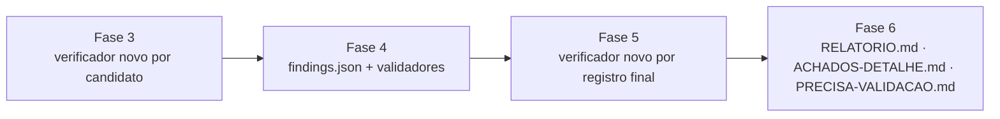

# Validação, saída estruturada, verificação e relatório



### Fase 3: Valide de forma independente cada candidato

Depois da passada limpa do crítico de cobertura ou de uma parada antecipada registrada explicitamente, consolide os candidatos da Fase 2 e as confirmações carregadas da rodada anterior sobre a mesma fonte por fingerprint estável e causa raiz. Entregue cada candidato único proposto como `confirmed` ou `needs_validation` a um verificador `general-purpose` novo, que não o caçou. Uma confirmação carregada da rodada anterior segue o mesmo caminho de verificação atual, mesmo que os caçadores excluam essa causa raiz inalterada. Um verificador pode ler artefatos do caçador ou da rodada anterior, mas deve reler cada localização de código-fonte atual citada e executar de forma independente qualquer checagem decisiva que consiga reproduzir com segurança.

Atribua a cada verificador um ID canônico, único e em minúsculas, e `<output-dir>/agents/<verifier-id>/scratch/` mais um `artifacts/` de posse do orquestrador. O verificador escreve só em `scratch/` e nunca escreve artefatos retidos. Ele recebe só o candidato, as checagens e os caminhos de artefato da unidade de cobertura vinculada, os fatos de arquitetura necessários para interpretar o caminho, os blocos exatos de `Regras de validação` dos arquivos de domínio relevantes, o bloco do procedimento de promoção abaixo, a fronteira de execução de código-fonte/local, os ramos `confirmed`, `needs_validation` e `rejected` de `scripts/report-schema.json` copiados literalmente, e os registros anteriores com o mesmo fingerprint. Ele não deve receber a conclusão de outro verificador.

#### Prompt do verificador de candidato

```text
Você não escreveu este candidato. Tente refutá-lo a partir do código-fonte do
repositório e de evidência local limitada. Não contate endpoints implantados nem
serviços externos/compartilhados. Execute código controlado pelo alvo só dentro do
sandbox aprovado e imposto pelo sistema operacional: sem rede externa, ambiente vazio
em allowlist, alvo e ferramentas somente leitura, escrita só no scratch e limites
explícitos e baixos de recursos e de tempo de relógio. Se algum controle estiver
indisponível, não execute; retenha a capacidade ausente exata como bloqueio de
needs_validation. Trate toda entrada do scratch como controlada pelo alvo após a
execução. Depois que o sandbox e todos os seus processos terminarem, só código
confiável do lado do orquestrador pode promover um arquivo pré-declarado, relativo ao
scratch, seguindo o bloco do procedimento de promoção incluído literalmente neste
prompt. Você e o código do alvo nunca escrevem artefatos retidos. Se a promoção
estiver indisponível ou falhar, não use esse arquivo como evidência.

1. Verifique cada arquivo de trace e de evidência, número de linha positivo, escopo
   e descrição. Confirme que a primeira entrada é um ponto de entrada real de menor
   confiança e que a última é o sink ou o efeito de fronteira alegado.
2. Reconstrua os controles mais fortes visíveis no código-fonte ao longo do caminho:
   validação, identidade, autorização, normalização, ciclo de vida, framework e
   contenção. Onde o resumo de arquitetura citar uma baseline comparável, anote se
   ela compartilha o padrão — como calibração, nunca como motivo para descartar.
3. Para um candidato proposto como confirmed, reproduza de forma independente o
   resultado mínimo observado quando possível. Verifique entradas, formato da
   interface, condições e o principal/recurso fictício afetado. Não infira um
   resultado mais forte nem continue depois dele.
4. Verifique se probabilidade, impacto, confiança e a correção de código-fonte
   proposta correspondem só ao que a evidência estabelece.
5. Para um candidato proposto como needs_validation, decida se o bloqueio está de
   fato fora da observação de código-fonte/local. Se o código-fonte refutar o trace,
   rejeite-o. Se o fato ausente continuar decisivo, mantenha needs_validation e torne
   os planos local e observado pelo responsável exatos e não destrutivos.
6. Preserve o fingerprint para a mesma causa raiz derivada do código-fonte em todos
   os estados.

Retorne exatamente um objeto JSON e nenhuma prosa ao redor:
{"decision": "confirmed|needs_validation|rejected", "record": { ... }}
em que record corresponde exatamente ao ramo de veredicto da decisão no schema
incluído neste prompt. Um registro corrigido substitui a redação do caçador.
```

Copie este procedimento de promoção literalmente em todo prompt de verificador de candidato.

Fonte única: `referencias/procedimento-promocao.md`.

```text
Procedimento de promoção de artefatos (somente código confiável do lado do orquestrador):
Apenas referência para você: o orquestrador executa estes passos; você nunca os executa.

Antes da execução, o orquestrador abre e retém descritores de diretório confiáveis e
não herdáveis para as raízes scratch/ e artifacts/ do agente, e registra uma allowlist
dos arquivos de artefato esperados (relativos ao scratch) com limites explícitos de
bytes por arquivo e acumulado. Nunca passe esses descritores ao agente nem ao sandbox.
Depois que o sandbox e todos os seus processos terminarem, código confiável do lado do
orquestrador promove cada arquivo da allowlist separadamente:

1. Valide o caminho relativo declarado: rejeite componentes absolutos, vazios, `.`,
   `..` ou que sejam symlink.
2. Percorra cada componente pai a partir do descritor retido da raiz scratch com
   operações relativas a diretório e sem seguir links; nunca reabra por caminho.
3. Abra a folha sem seguir links e em modo não bloqueante.
4. Confirme com `fstat` que é um arquivo regular, com contagem de links exatamente um
   e dentro dos limites de bytes registrados (por arquivo e acumulado).
5. Aplique esses limites de novo durante a leitura desse descritor.
6. Copie exatamente o tamanho verificado, repita o `fstat` e rejeite se a identidade,
   o tipo, a contagem de links ou o tamanho mudarem.
7. No destino, percorra cada componente pai a partir do descritor retido da raiz
   artifacts com operações relativas a diretório e sem seguir links; exija que cada
   componente existente seja um diretório real e crie de forma exclusiva qualquer
   diretório ausente antes de reabri-lo e verificá-lo sem seguir links.
8. Crie a folha de forma exclusiva sem seguir links, confirme que o destino aberto é
   um arquivo regular com contagem de links exatamente um e copie a partir do
   descritor de origem verificado, sem reabrir nenhum dos dois caminhos.
9. Em sistemas não POSIX, use APIs equivalentes e seguras contra corrida.
10. Nunca copie recursivamente nem use glob no scratch, nunca extraia arquivo compactado
    dentro de artifacts e nunca abra ou promova symlink, FIFO, socket, dispositivo,
    diretório, arquivo com hard link, arquivo que esteja mudando ou que exceda o limite.
11. Se alguma conferência estiver indisponível, não puder ser aplicada ou falhar,
    descarte a entrada do scratch; se ela for evidência decisiva, mantenha
    `needs_validation` com o bloqueio exato da promoção.
```

Um verificador só pode promover `needs_validation` a `confirmed` depois de estabelecer de forma independente o caminho completo e o resultado observado limitado. Rebaixe uma confirmação proposta para `needs_validation` quando um fato específico de deploy ou de runtime continuar desconhecido. Use `rejected` quando o código-fonte, o comportamento local, um controle visível, a ausência de impacto relevante ou um pré-requisito impossível refutar a alegação. `needs_validation` nunca é estacionamento para uma ideia especulativa.

O orquestrador confere se cada verificador devolveu o mesmo fingerprint, a menos que tenha identificado uma causa raiz genuinamente diferente. Mescle as correções, registre a decisão em cada unidade de cobertura vinculada e garanta que haja um registro final por fingerprint. Descarte um resultado de verificador malformado ou envolto em prosa sem consertá-lo; rode de novo esse candidato com um verificador novo quando o orçamento permitir; caso contrário, ele continua como candidato não validado no ledger, sob a regra de rodada incompleta.

Quando a evidência do verificador atualizar uma checagem do ledger, defina o `agent_id` dessa checagem como o ID canônico do verificador e liste seus `reviewed_paths` não vazios e relativos ao repositório. Mantenha os `reviewed_paths` da unidade iguais à união entre as checagens. Use `method: "source"` com `artifact: null` para revisão só de código-fonte. Use `method: "local"` só com um arquivo promovido com sucesso por código confiável do lado do orquestrador para dentro de `agents/<check.agent_id>/artifacts/`. A unidade mantém o responsável original da atribuição, de modo que checagens de caçador e de verificador com responsáveis independentes podem coexistir. Para a unidade `planned` semeada a partir de um registro carregado da rodada anterior não há responsável anterior: o verificador que a rechecar se torna o responsável pela atribuição da unidade, e sua rechecagem é a primeira checagem da unidade, movendo a unidade para `candidate` com o fingerprint carregado.

Se um orçamento estrito de total de agentes não cobrir todos os candidatos, defina o status da rodada como incompleto e siga a regra determinística de orçamento do `SKILL.md`. Um candidato não validado permanece só no ledger. Ele não entra em `findings.json` sob nenhum veredicto.

### Fase 4: Escreva e valide o `findings.json`

O orquestrador escreve todos os registros decididos de forma independente em `<output-dir>/findings.json`, ordenados por fingerprint. Inclua:

- `confirmed`: vulnerabilidades fundamentadas no código-fonte, com evidência completa de execução local, condições, remediação específica, probabilidade/impacto/severidade geral e confiança.
- `needs_validation`: candidatos fundamentados no código-fonte, com um bloqueio exato não resolvido e pelo menos um plano aplicável, local ou de deploy observado pelo responsável.
- `rejected`: candidatos fundamentados no código-fonte refutados durante a validação, retidos para que rodadas futuras não repitam a alegação sem sustentação sem evidência alterada.

Leia `scripts/report-schema.json` imediatamente antes de escrever. Ele usa `additionalProperties: false`; não leve campos de wrapper do caçador para um registro. Mantenha estes contratos de veredicto distintos:

- Um registro `confirmed` usa `root_cause`, `intended_behavior`, `conditions`, `execution`, `remediation`, `severity` e `confidence`. Ele não deve usar `claimed_root_cause`, `blockers`, `validation_plan` nem `reason`. `execution` é neutro quanto ao alvo e usa a interface nativa do alvo: entrada de API/HTTP, chamada de CLI, chamada de biblioteca, mensagem, fixture de arquivo, ação de navegador, política renderizada ou harness local, conforme o caso. `observed_result` é não vazio e factual.
- Um registro `needs_validation` usa `claimed_root_cause`, `trace`, `evidence`, `blockers` e pelo menos um campo não vazio entre `validation_plan.local` e `validation_plan.deployment`. Inclua os dois só quando os dois contextos puderem resolver fatos distintos. Ele não deve usar severidade, execução, remediação, motivo nem causa raiz confirmada.
- Um registro `rejected` usa `claimed_root_cause`, `trace`, `evidence` e `reason`. Ele não deve usar severidade, execução, remediação, bloqueios, plano de validação nem causa raiz confirmada.

Todo registro tem fingerprint estável, título, descrição e caminhos de código-fonte relativos ao repositório. Um trace de múltiplas etapas começa com `entrypoint`, termina com `sink` e usa `propagation` só entre eles. Traces de uma entrada usam `entrypoint` ou `sink`. A severidade geral não pode exceder o impacto demonstrado.

Rode:

```sh
node <skill-dir>/scripts/validate-findings.cjs <output-dir>/findings.json
node <skill-dir>/scripts/validate-coverage-ledger.cjs <output-dir>/coverage-ledger.json
```

Corrija todo erro estrutural e semântico antes de continuar. O validador de achados rejeita entrada acima de 5 MiB, de 1.000 achados de nível superior ou de 64 níveis de aninhamento, e limita a saída de erros reportados a 100 mensagens. O sucesso do validador prova só o formato e a consistência do ledger.

### Fase 5: Verifique os registros finais com olhos novos

Lance um verificador `Explore` novo por registro final `confirmed` e `needs_validation`, em paralelo. Esse verificador checa o registro estruturado, não o relato do caçador, e permanece dentro das fronteiras de código-fonte/local.

Em uma rodada `quick`, a Fase 3 e a Fase 5 se fundem: o verificador da Fase 3 também faz estas checagens de registro e devolve o registro final no formato do schema, de modo que cada candidato recebe um revisor novo e independente em vez de dois. Todos os outros perfis mantêm as duas passadas separadas. Nunca pule a revisão independente de um registro `confirmed` em nenhum perfil.

Para `confirmed`, exija que ele cheque:

1. Cada caminho de trace/evidência relativo ao repositório, linha, escopo e operação descrita.
2. A interface de entrada real e o formato exato da entrada local.
3. Cada condição, etapa de parser/política, camada preventiva visível no código-fonte e resultado local observado.
4. O principal/recurso afetado e o impacto demonstrado.
5. Separação de severidade: probabilidade realista, impacto demonstrado, geral não maior que o impacto.
6. A estratégia de remediação e quaisquer `code_changes`, incluindo se a correção impõe o invariante sem apenas mover a confiança de lugar.

Para `needs_validation`, exija que ele cheque:

1. O caminho no código-fonte é real e sustenta só a `claimed_root_cause` declarada.
2. Cada bloqueio listado é decisivo e ainda não respondível localmente.
3. O candidato nomeia uma fronteira e um resultado concreto possível, em vez de uma preocupação genérica.
4. Pelo menos um campo do plano de validação está presente e é exato. `local` usa uma fixture limitada; `deployment` pede a um responsável que observe um fato de configuração, identidade, rota, política ou runtime. Não invente um plano para um contexto inaplicável e nunca envie tráfego de auditoria a um deploy.
5. O fingerprint corresponde aos registros anteriores/atuais para a mesma causa raiz.

Cada verificador devolve exatamente um objeto JSON: `{"decision":"verified","fingerprint":"..."}` ou `{"decision":"replace","reason":"...","record":{...}}`, sem prosa ao redor. Um registro de substituição deve corresponder ao seu ramo de schema `confirmed`, `needs_validation` ou `rejected`. Trate um resultado da Fase 5 malformado ou envolto em prosa do mesmo jeito que na Fase 3: descarte-o sem consertá-lo e rode de novo com um verificador novo quando o orçamento permitir.

Não aplique como final uma substituição da Fase 5 que promova um registro a um veredicto mais forte, incluindo qualquer promoção a `confirmed`, ou que mude materialmente a causa raiz, o trace, a entrada de execução ou o resultado observado, o impacto demonstrado ou a severidade. Entregue essa substituição completa a um novo verificador independente que não tenha caçado, feito a validação da Fase 3 nem proposto a substituição da Fase 5. O novo verificador recheca o código-fonte atual e reproduz de forma independente qualquer resultado local decisivo sob a fronteira de execução, e então devolve `verified` ou outra substituição. Aplique uma substituição material só depois dessa verificação nova. Se resultar outra substituição material, repita com um verificador novo. Se faltar orçamento ou independência, remova o registro em disputa do `findings.json`, mantenha sua unidade no ledger como candidato não resolvido e defina `run_status: "incomplete"` com um `incomplete_reason` exato. Correções não materiais de redação ou de linha no repositório podem ser aplicadas diretamente quando não mudam o significado nem a evidência.

Depois de cada substituição aplicada, rode de novo os dois validadores e atualize as decisões vinculadas no ledger. Se um verificador final identificar uma causa raiz separada, atribua um novo fingerprint e envie-o pela validação independente de candidato antes da inclusão. Defina `run_status: "complete"` só quando todo candidato do ledger tiver uma disposição final independente e todo registro retido passar na Fase 5.

Não verifique só os registros `confirmed`. Um repasse `needs_validation` enganoso desperdiça o tempo do responsável e pode preservar uma premissa falsa.

### Fase 6: Produza relatórios neutros quanto ao alvo a partir dos registros finais

Só depois que a Fase 5 passar para todo registro retido em `findings.json`, derive a prosa dos registros finais, do ledger e das notas de `hardening` do caçador retidas na contabilidade do ledger. Uma rodada incompleta pode reportar registros verificados de forma independente, mas deve identificar cada candidato não resolvido do ledger e não deve apresentá-lo como achado. Os arquivos de prosa nunca mudam um veredicto, uma severidade, um bloqueio ou um impacto demonstrado.

**Rótulos e IDs de exibição.** No JSON a severidade fica em inglês; no texto dos relatórios use os rótulos em português do glossário: `critical` → Crítico, `high` → Alto, `medium` → Médio, `low` → Baixo, `informational` → Informativo. Cada achado `confirmed` recebe também um ID de exibição `V-01`, `V-02`… atribuído pela ordem de severidade (Crítico primeiro) e, dentro da mesma severidade, pela ordem do fingerprint, para casar com o padrão de IDs da skill `auditoria` (D-, A-, B-, P-, S-). O ID de exibição existe só na prosa; ele não entra no `findings.json` nem substitui o fingerprint. (adaptação do claude-bootstrap)

**Segredos na evidência.** Qualquer segredo citado em evidência, reprodução ou saída observada nos relatórios vai truncado (por exemplo `eyJ...<truncado>`), nunca inteiro. (adaptação do claude-bootstrap)

#### `RELATORIO.md`

Escreva:

1. Perfil da rodada, escopo, orçamento (se definido) com agentes gastos versus planejados, ref do código-fonte, declaração de execução em sandbox restrita a código-fonte e local, uso da rodada anterior e cobertura `deferred` e fora de escopo explícita. Nomeie as confirmações carregadas da mesma fonte e as revalidações por fonte alterada. Uma rodada `quick`, com escopo, limitada por orçamento ou incompleta declara claramente que é uma passada parcial. Se a validação de candidatos esgotou um orçamento estrito, declare que a rodada está incompleta e liste cada fingerprint não validado e a unidade vinculada; não descreva esses candidatos como achados. Se o orçamento impediu um crítico obrigatório, declare qual crítico não rodou e não faça nenhuma alegação de cobertura limpa.
2. Um resumo curto da postura de segurança.
3. Uma tabela de achados confirmados: ID de exibição, severidade, título, fronteira afetada e resultado observado em uma linha.
4. Cada achado confirmado: localização no código-fonte do repositório, principal de menor confiança, reprodução limitada na interface nativa do alvo, condições, resultado real, impacto, justificativa de prioridade e a menor correção no código-fonte.
5. Uma tabela separada `PRECISA DE VALIDAÇÃO`. Dê, para cada pista, título, trace no repositório, bloqueio exato, próximo passo local limitado e checagem segura de deploy observada pelo responsável. Não atribua severidade nem a chame de vulnerabilidade confirmada.
6. Notas de hardening e padrões positivos no código-fonte, separadas.
7. Resumo de cobertura a partir do ledger: contagens de `covered`, `candidate`, `blocked` e `deferred`, mais as exclusões importantes e o resultado final do crítico.

Não descreva registros `rejected` como achados. Mencione seus fingerprints só quando explicarem uma divergência anterior ou uma decisão de cobertura.

#### `ACHADOS-DETALHE.md`

Para cada registro confirmado `medium`, `high` ou `critical` (Médio, Alto ou Crítico), copie o caminho completo no código-fonte e a reprodução local neutra quanto ao alvo:

- trace e evidência ordenados e relativos ao repositório;
- atacante/principal fictício e recurso fictício afetado;
- entrada, invocação ou fixture nativa e instruções limitadas exatas;
- saída observada e o invariante de segurança que ela prova;
- condições e contenção;
- remediação no nível do código-fonte e caso de regressão.

#### `PRECISA-VALIDACAO.md`

Para cada registro não resolvido, copie o trace no código-fonte, a evidência verificada, o bloqueio exato, a fronteira afetada e cada plano de resolução aplicável, local limitado ou observado pelo responsável. Mantenha-os como pistas priorizadas sem severidade. Não os transforme em orientação de teste ao vivo nem presuma o fato de deploy ausente.

HTTP é uma interface nativa possível, não o padrão. Um achado de biblioteca pode usar uma chamada de função, um parser uma fixture, uma CLI um comando, um app desktop uma ação de IPC ou de arquivo, e a infraestrutura uma política renderizada localmente. Não exija um endpoint, uma conta externa ou um ambiente ao vivo que o alvo não tenha.

Mantenha o relatório proporcional à evidência. Uma rodada limpa pode ter zero registros confirmados. Declare esse resultado e os limites restantes de cobertura/validação sem inventar achados Baixo.
