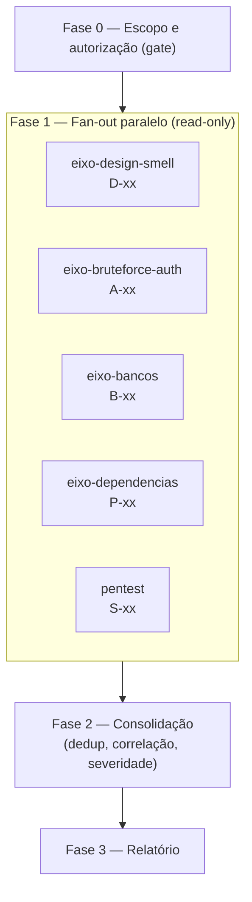

# Auditoria técnica completa (orquestrador)

Um nível acima da skill `pentest`: ela revisa **uma** frente (segurança por contrato); esta
**orquestra todas** e fecha num relatório único. Dado um alvo autorizado, dispara **um subagente
read-only por eixo em paralelo**, cada um devolvendo achados reproduzíveis e cobertura declarada,
e consolida tudo.

| Eixo | Arquivo | Subagente | Resumo |
|---|---|---|---|
| Design System / Smell Code | `eixos/design-smell.md` | `eixo-design-smell` | consistência de UI, tokens, duplicação, code smells, acoplamento |
| Brute Force / Auth | `eixos/bruteforce-auth.md` | `eixo-bruteforce-auth` | freios por conta+origem, lockout, senha, MFA, enumeração |
| Bancos | `eixos/bancos.md` | `eixo-bancos` | injection, query dinâmica, IDOR no dado, migrations, segredo, PII |
| Dependências | `eixos/dependencias.md` | `eixo-dependencias` | CVEs, versão desatualizada, supply chain, lockfile, licença |
| Segurança por contrato | (reusa a skill `pentest`) | `pentest` | as 8 perguntas por rota, inventário mecânico |

Cada achado usa `templates/achado.md`; o consolidado usa `templates/consolidado.md`.

## Regra que vem antes de tudo: autorização e ambiente

Herdada da skill `pentest`, vale para a auditoria inteira:

1. **Só sistema do cliente com autorização, ou seu, e só ambiente descartável** (local/homologação)
   para qualquer conferência. Em produção: **só leitura** e só o que o dono autorizou por escrito.
2. **Os subagentes são read-only.** Eles leem o código, provam o achado por `arquivo:linha` e
   **descrevem** a bateria dinâmica — inclusive o brute force ao vivo — como passos para o usuário
   rodar no ambiente dele. Nenhum agente dispara ataque, gera carga, bloqueia conta ou muda estado.
3. **Nada de segredo na saída:** token truncado (`eyJ...<truncado>`), senha nunca colada, URL
   assinada mascarada, string de conexão sem a credencial.
4. **Inventário antes de opinião.** Cada eixo fecha com **cobertura declarada** (total / revisado /
   não coberto). Resumo de subagente sem cobertura declarada não vale — revisão por tema parece
   completa e deixa passar mais da metade.
5. **Só entra achado reproduzível** com número concreto. Tente derrubar o próprio achado antes de
   registrar.

## Fase 0 — Escopo e autorização (gate)

Antes de disparar qualquer agente, confirme e anote no topo de `templates/consolidado.md`:

- **Alvo:** caminho do repositório e/ou URL. Stack (framework, banco, borda).
- **Autorização:** é sistema do cliente com contrato/autorização, ou seu? Teste ativo vai contra
  homologação/local, nunca produção sem autorização escrita.
- **Eixos pedidos:** todos (`completo`) ou um (`eixo <nome>`).
- **Fora de escopo:** infra de terceiros, serviço de parceiro.

Se faltar a confirmação de autorização, **pare e pergunte** — não dispare os agentes.

## Fase 1 — Fan-out (os subagentes, em paralelo)

Dispare **em uma única leva** (um bloco de chamadas à ferramenta Agent) um subagente por eixo
pedido. Cada um roda isolado e read-only. No prompt de cada subagente:

- aponte o eixo (`Leia auditoria/eixos/<eixo>.md e audite o alvo <caminho> seguindo aquele checklist`);
- exija a saída no formato de `templates/achado.md`, um card por achado, com `arquivo:linha`;
- exija o rodapé de **cobertura declarada** (o que foi varrido, o que não foi e por quê);
- proíba segredo na saída e qualquer ação que não seja leitura.

Para o eixo **segurança por contrato**, use a skill `pentest` — não reimplemente as 8 perguntas
aqui. Se o projeto-alvo tiver agentes de eixo em `.claude/agents/`, delegue por nome; senão, passe
o conteúdo do eixo no prompt.

## Fase 2 — Consolidação

Junte os retornos e monte `templates/consolidado.md`:

- **Deduplique** achados que dois eixos acharam (ex.: um segredo em conexão aparece em Bancos e em
  Dependências) — um card só, citando os dois ângulos.
- **Correlacione entre eixos:** o achado que só é crítico junto com outro (ex.: sem freio de login
  *e* política de senha fraca = brute force viável). Diga isso no veredito.
- **Priorize por severidade** (Crítico / Alto / Médio / Baixo).
- **IDs por eixo:** `D-01` (design/smell), `A-01` (auth/brute force), `B-01` (bancos), `P-01`
  (dependências), `S-01` (segurança por contrato).
- Feche com a **tabela de cobertura** somando os eixos. "Não coberto" é informação, não vergonha.

## Fase 3 — Relatório

Entregue o `consolidado.md` preenchido, com os cards em anexo. Se você tiver um template de
relatório próprio (HTML/PDF da sua empresa), converta a partir dele — a estrutura que funciona:

1. Capa — tipo "Auditoria Técnica", projeto, data, classificação "Confidencial".
2. Sumário executivo — veredito e panorama por eixo.
3. Escopo e método — o que foi auditado e como.
4. Achados — Evidência / Impacto / Recomendação, **número concreto em todo achado**.
5. Cobertura e o que não foi coberto.
6. Plano proposto — ação, esforço, quando.

Antes de entregar: nenhum placeholder `<...>` sobrando, nenhum segredo na evidência.

## Modos

- **`completo`** (padrão): Fase 0 → todos os eixos → consolidação → relatório.
- **`eixo <nome>`**: roda só aquele eixo e devolve os cards.
- **`relatorio`**: pula a varredura, pega os cards já levantados e só monta o relatório.

## O que a auditoria **não** faz sozinha

- Não dispara brute force, scan ou carga ao vivo — descreve o passo para o usuário rodar no
  ambiente dele.
- Não aplica correção — propõe no card. Ao propor, confira que o conserto não abre outra porta
  (bloqueio por conta mal desenhado vira negação de serviço).
- Não publica nem envia nada ao cliente sem o usuário mandar.
