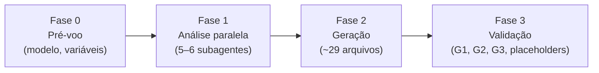

# Bootstrap do Claude Code

Analisa o projeto atual e gera toda a estrutura de trabalho do Claude Code com conteúdo
**100% específico** do projeto: nomes, comandos, padrões e caminhos reais.



| Arquivo de referência | Conteúdo | Quando ler |
|---|---|---|
| `referencias/diretrizes.md` | G1 (sem Co-Authored-By), G2 (modelo dos agentes), G3 (Mermaid + tabelas) | Antes da Fase 1 |
| `referencias/arquivos-base.md` | CLAUDE.md, AGENTS.md, .mcp.json, settings, memory-bank | Fase 2 |
| `referencias/agentes.md` | Formato e conteúdo obrigatório dos 11 subagentes | Fase 2 |
| `referencias/comandos.md` | Os 6 slash commands | Fase 2 |

## Fase 0 — Pré-voo

1. **Modelo e esforço.** Este setup gera ~29 arquivos interdependentes numa sessão longa; vale
   rodar com o modelo mais capaz disponível e esforço máximo (`/model opus` + `/effort max`).
   Se a sessão estiver num modelo menor ou com esforço baixo, **avise o usuário e pergunte se quer
   continuar** — o resultado tende a sair genérico.
2. **Variáveis do projeto.** Resolva a partir de `$ARGUMENTS`; o que faltar, detecte ou pergunte
   numa única pergunta:

   | Variável | Descrição | Exemplo | Se não houver |
   |---|---|---|---|
   | `$ORG_PATH` | Pasta-mãe dos projetos da organização | `~/projetos/minha-org/` | `--standalone`: remover Subagente 6 e toda navegação cross-project |
   | `$SIBLING_PROJECTS` | Projetos irmãos, 1 linha cada | `api-auth — Auth`, `common-lib — Shared` | Detectar listando `$ORG_PATH` |
   | `$ORG_SKILL_NAMESPACE` | Namespace de skills organizacionais | `minha-org` | Omitir `skills:` do frontmatter e `Skill` dos tools |

3. **Leia `referencias/diretrizes.md`.** G1, G2 e G3 valem para todo arquivo gerado.
4. **Arquivos existentes.** Se já houver `CLAUDE.md`, `AGENTS.md` ou `.claude/`, leia antes e
   pergunte se é para mesclar ou substituir. Nunca sobrescreva em silêncio.

## Fase 1 — Análise paralela com subagentes

Lance **em uma única leva** (um bloco de chamadas à ferramenta Agent) os subagentes abaixo, antes
de escrever qualquer arquivo. Cada um devolve um relatório estruturado.

| # | Subagente | Lê | Devolve |
|---|---|---|---|
| 1 | Stack & Dependencies Scout | Todos os manifests (`package.json`, `pyproject.toml`, `go.mod`, `Cargo.toml`, `pom.xml`, `composer.json`, `Gemfile`…) | Linguagens, frameworks, versões exatas, scripts, pacotes internos da org |
| 2 | Architecture & Patterns Scanner | Estrutura de pastas (4 níveis), entrypoints, controllers, services, repositories, models, middlewares, guards, configs | Padrão arquitetural (MVC, hexagonal, DDD, monólito modular, microserviços), camadas, convenções de nome reais, diagrama |
| 3 | Security & Config Auditor | `.env.example`, Docker, nginx, CI/CD, auth guards, CORS/CSRF/Helmet | Inventário de configs, pontos de entrada (REST, WS, GraphQL, webhooks, gRPC), riscos OWASP Top 10 |
| 4 | Business Logic & Domain Analyzer | Rotas, controllers, services, handlers | Domínios, entidades (inclusive em pacotes internos), fluxos, integrações externas, TODO/FIXME |
| 5 | Test & Quality Scanner | Configs de teste e lint, `*.spec.*`/`*.test.*`, helpers, coverage | Framework, localização dos testes, cobertura, padrões de mock/factory, gaps |
| 6 | Local Ecosystem Discovery *(opcional)* | `$ORG_PATH`: `package.json`, `README.md`, `AGENTS.md` de cada irmão | Mapa do ecossistema, dependências cruzadas, comunicação entre serviços |

> O Subagente 6 só existe se o projeto faz parte de um ecossistema. Os agentes podem **ler**
> livremente em `$ORG_PATH`, mas nunca modificar arquivos fora do projeto atual sem aprovação.

## Fase 2 — Gerar os arquivos

**Checkpoint antes de escrever:** todos os relatórios voltaram? Há dados reais suficientes? Se
faltar algo, lance análise adicional — **não use placeholder**.

Gere na ordem abaixo, seguindo as referências:

| Ordem | Arquivo(s) | Referência |
|---|---|---|
| 1 | `CLAUDE.md` (≤ 180 linhas) | `arquivos-base.md` |
| 2 | `AGENTS.md` | `arquivos-base.md` |
| 3 | `.mcp.json` | `arquivos-base.md` |
| 4–5 | `.claude/settings.json` (commitável) e `.claude/settings.local.json` (pessoal) | `arquivos-base.md` |
| 6–11 | `memory-bank/` — 6 arquivos (≤ 150 linhas cada) | `arquivos-base.md` |
| 12–22 | `.claude/agents/` — até 11 subagentes | `agentes.md` |
| 23–28 | `.claude/commands/` — 6 slash commands | `comandos.md` |

## Fase 3 — Validação e relatório final

Releia **todos** os arquivos gerados e rode:

```bash
# Placeholders que sobreviveram (deve voltar vazio)
grep -rnE '\[(nome real|stack|Nome Real)[^]]*\]|\$ORG_PATH|\$SIBLING_PROJECTS|\$ORG_SKILL_NAMESPACE' \
  CLAUDE.md AGENTS.md memory-bank/ .claude/

# G1 — Co-Authored-By só pode aparecer como proibição
grep -rn "Co-Authored-By" .claude/ CLAUDE.md AGENTS.md

# G2 — todo agente com o mesmo modelo (deve voltar uma única linha)
grep -h "^model:" .claude/agents/*.md | sort -u

# G3 — Mermaid obrigatório
grep -q '```mermaid' CLAUDE.md || echo "FALHA G3: CLAUDE.md sem mermaid"
grep -q '```mermaid' AGENTS.md || echo "FALHA G3: AGENTS.md sem mermaid"
[ "$(grep -c '```mermaid' memory-bank/systemPatterns.md)" -ge 2 ] \
  || echo "FALHA G3: systemPatterns.md precisa de ≥ 2 mermaid"
```

Confira também: cada agente tem `description` precisa (é o gatilho de auto-delegação) e só os
`tools`/`skills` de que realmente precisa.

Entregue ao usuário:

1. **Inventário** — tabela com cada arquivo criado e seu propósito.
2. **Resultado das verificações** acima (placeholders, G1, G2, G3).
3. **Top 3 riscos de segurança** encontrados na análise.
4. **Recomendações imediatas** — o que fazer primeiro com os agentes.
5. **Comandos para começar:** `/agents`, `/security-scan`, `/explain-codebase`, `/update-memory`.
6. **Perguntas para o desenvolvedor** — o que não foi possível inferir do código.

## Regras desta execução

- **Conteúdo:** 100% específico do projeto. Zero placeholder, zero texto genérico.
- **Análise:** subagentes em paralelo; diante de ambiguidade, pesquise mais em vez de assumir.
- **Agentes:** `description` precisa; tools mínimos; protocolo de pesquisa autônoma ("não pergunte
  ao usuário o que pode ser pesquisado"); proibição de lint automático em todo agente que escreve
  código; nunca reformatar código existente.
- **Estrutura:** `CLAUDE.md` ≤ 180 linhas, detalhes vão para `memory-bank/` referenciados com `@path`.
- **Permissões:** `settings.json` = base + deny list + hooks (commitável); `settings.local.json` =
  MCPs, skills, GitHub CLI, domínios de WebFetch (pessoal, no `.gitignore`).
