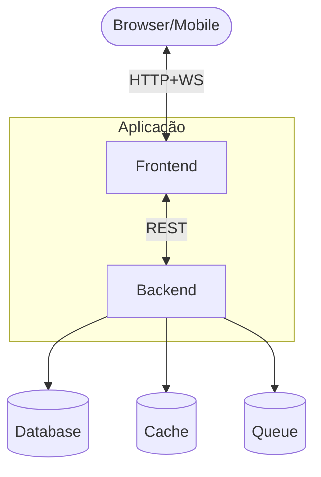

# Diretrizes globais (G1, G2, G3)

Valem em toda execução e **devem ser propagadas** para os arquivos gerados (CLAUDE.md, AGENTS.md,
agentes e commands).

## G1 — Commits sem `Co-Authored-By`

- **Nunca** adicionar o trailer `Co-Authored-By:` em mensagens de commit ou PR geradas pelo Claude
  Code ou por subagentes (inclui `Co-Authored-By: Claude` e qualquer variação).
- **Onde aplicar:**

  | Arquivo | Seção |
  |---|---|
  | `CLAUDE.md` | Proibições Absolutas |
  | `AGENTS.md` | Convenções › Commits |
  | Agentes `backend`, `frontend`, `bug-fix`, `new-features`, `pr-writer`, `devops`, `architect` | Linha: "NUNCA inclua o trailer Co-Authored-By em sugestões de commit ou PR." |
  | Agente `reviewer` | Item de checklist: trailer presente → CRÍTICO |
  | Command `/create-pr` | Passo obrigatório |

- **Por quê:** o histórico Git fica atribuído exclusivamente ao autor humano que fez o commit.

## G2 — Mesmo modelo em todos os agentes

- Todo `.claude/agents/*.md` tem `model: opus` no frontmatter. Sem mistura de `sonnet`/`haiku`.
- `CLAUDE.md` deve registrar: "Todos os agentes têm `model: opus` no frontmatter (alias para o Opus
  mais recente)". `AGENTS.md` deve registrar: "Modelo padrão dos subagentes: `model: opus`".
- **Use alias no frontmatter** (`opus`, `sonnet`, `haiku`, `inherit`), não o ID completo do modelo.
  O alias acompanha a versão mais recente sem precisar editar os agentes.
- Para reduzir custo numa chamada específica, o usuário faz override manual; o padrão continua `opus`.
- **Por quê:** coerência — todos os agentes raciocinam no mesmo nível, sem regressão quando um
  agente "leve" precisa entender contexto pesado.

> Quer outra política (ex.: `sonnet` nos agentes de leitura)? Troque aqui **antes** de rodar; a
> validação da Fase 3 só exige que todos os agentes usem o mesmo valor.

## G3 — Visualização obrigatória (Mermaid + tabelas)

Documentação em prosa pura é frágil. Diagramas e tabelas reduzem ambiguidade e tornam a revisão
humana viável em segundos.

**Ordem de preferência:** Mermaid → tabela Markdown → bloco de código → árvore ASCII → callout
(`> NOTE:` / `> WARNING:`). Prosa só para o contexto que o diagrama não captura.

| Contexto | Tipo Mermaid | Onde |
|---|---|---|
| Arquitetura de alto nível | `flowchart TB` | `CLAUDE.md` (resumo), `systemPatterns.md` (detalhe) |
| Fluxo de request | `sequenceDiagram` | `systemPatterns.md`, agentes `architect`/`backend` |
| Máquina de estados | `stateDiagram-v2` | `systemPatterns.md` |
| Modelo de dados | `erDiagram` | `systemPatterns.md`, agente `backend` |
| Hierarquia de módulos | `classDiagram` | `systemPatterns.md` |
| Filas / workers | `flowchart LR` com subgraphs | `systemPatterns.md` |
| Deploy / CI-CD | `flowchart LR` | `techContext.md`, agente `devops` |
| Roadmap | `gantt` ou tabela de status | `progress.md` |
| Decisões e trade-offs | Tabela comparativa | `productContext.md`, agente `architect` |

**Mínimos obrigatórios:**

| Arquivo | Exigência |
|---|---|
| `CLAUDE.md` | ≥ 1 `flowchart TB` da arquitetura (ASCII só como complemento) |
| `AGENTS.md` | ≥ 1 Mermaid da estrutura de pastas + tabela de comandos |
| `memory-bank/systemPatterns.md` | ≥ 2 Mermaid: arquitetura expandida, fluxo principal; + estados, ER e filas quando existirem |
| `memory-bank/techContext.md` | Mermaid de deploy (se pipeline não trivial) + tabela de stack com versões |
| `memory-bank/progress.md` | Tabela `Status \| Item \| Owner \| Data` no lugar de bullets soltos |
| Agentes de fluxo (`architect`, `backend`, `bug-fix`, `new-features`, `devops`) | ≥ 1 Mermaid do fluxo de trabalho ou do domínio |

**Esqueleto da seção de arquitetura no `CLAUDE.md`:**

````markdown
## Arquitetura



[3–5 linhas sobre os trade-offs que o diagrama não captura]
````
