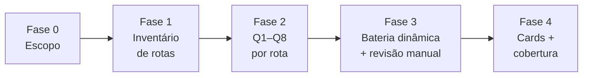

# Rotina de revisão de segurança (ataque por contrato)

Nasceu de um pentest externo real (25 achados) e das varreduras internas que vieram depois. A lição
principal: **o time de segurança quase não olha o front.** Pega o contrato da API (rota, corpo,
resposta, token) e pergunta o que acontece quando alguém chama **direto**, **fora de hora**, **por
outro caminho** ou **com outro tamanho**. Uma revisão anterior, feita por tema, deixou passar 14 dos
25 achados — e uma correção criou um achado novo (o bloqueio por conta virou negação de serviço).

Esta skill é um **método de revisão**: ler o código, provar o achado no seu próprio ambiente e
escrever o card. Ela não traz ferramenta de ataque pronta — os passos da bateria dinâmica são
conferências que você roda à mão contra um ambiente descartável seu.

| Arquivo | Para quê |
|---|---|
| `checklist.md` | Os itens a conferir, agrupados pelos 8 padrões, cada um com o que olhar no código e o resultado esperado |
| `templates/card.md` | Formato do card: Descrição, Como corrigir, Evidência, Referências |
| `templates/matriz-rotas.csv` | Cabeçalho da matriz rota × Q1–Q8 para o inventário |
| `templates/relatorio.md` | Relatório da rodada: escopo, cobertura declarada, achados e o que não foi coberto |

## Regras antes de começar

1. **Só ambiente seu e descartável** (local ou homologação). Em produção, só leitura e só o que o
   dono autorizar por escrito — qualquer conferência que gere carga, bloqueie conta ou mude estado
   tira gente de verdade do ar.
2. **Contas de teste em dobro:** dois tenants (A e B) de **cada** papel (dono, gestor, operador,
   admin). O IDOR e o "mesmo poder por outro caminho" só aparecem com o segundo tenant. Guarde as
   contas num arquivo fora do git (tem senha e token).
3. **Nada de segredo no relatório.** Token na evidência vai truncado (`eyJ...<truncado>`); URL
   assinada com a assinatura mascarada.
4. **Inventário antes de opinião.** Revisão por tema parece completa e não é. Sempre: listar tudo
   mecanicamente, revisar item a item, declarar total / revisados / não cobertos. Resumo de
   subagente sem cobertura declarada não vale.
5. **Só entra achado reproduzível** (`arquivo:linha` ou um passo de conferência com a resposta
   observada). Tente derrubar o próprio achado antes de registrar.

## As fases

### Fase 0 — Escopo (15 min)

Preencha o topo de `templates/relatorio.md`: serviços, domínios (produto, API, painel interno,
portal), ambientes, contas de teste, o que está fora (infra de terceiros, parceiro). Liste **todos**
os hosts públicos — um dos achados do pentest de origem foi uma API administrativa respondendo por
um domínio que ninguém achava que estava exposto. Se existe borda (CDN, API Gateway, load
balancer), anote quem termina o TLS e quem repassa o IP do cliente: os freios por origem dependem
disso.

### Fase 1 — Inventário das rotas (o passo que não pode falhar)

Liste **mecanicamente** toda rota HTTP e todo canal de tempo real do backend — não de memória, não
por tema. Em NestJS, procure os decoradores de rota e de guard; em Express/Fastify, o registro de
rotas; em outros frameworks, o roteador. Para cada rota, registre em `templates/matriz-rotas.csv`:
método, caminho, serviço, guard aplicado, DTO de entrada. Uma linha por rota. No fim, declare
**total de rotas / revisadas / não cobertas** — esse número é o que separa a revisão por inventário
da revisão por tema.

### Fase 2 — As 8 perguntas por rota

Para cada rota da matriz, responda Q1–Q8 (detalhe e o que olhar no código em `checklist.md`):

| # | Pergunta | O que se procura | Padrão |
|---|---|---|---|
| Q1 | **Quem chama?** | A rota tem guard? É o guard certo para o papel? Rota interna sem guard | P2 |
| Q2 | **De quem é o dado?** | O id no caminho/corpo é conferido contra o tenant logado? (IDOR) | P2 |
| Q3 | **O estado está fresco?** | Sessão revogada, vínculo encerrado, KYC recusado — a rota relê a cada request ou confia no token? | P1 |
| Q4 | **Tem outro caminho?** | Uma segunda rota/canal faz o mesmo sem a mesma trava? | P2 |
| Q5 | **A regra está no servidor?** | Limite/valor/permissão conferido no backend, ou só a tela esconde o botão? | P3 |
| Q6 | **Tem freio?** | Login, troca de senha, reenvio de código, criação de conta: limite por conta **e** por origem, fora da memória do processo (Redis)? O freio não vira DoS? | P4 |
| Q7 | **O contrato de entrada fecha?** | DTO com whitelist, tamanho máximo em todo campo e lista, tipo certo; entrada ruim dá 400, nunca 500 | P7 |
| Q8 | **A resposta é mínima?** | Devolve só o necessário, sem e-mail/telefone/URL assinada/dado anterior ao vínculo que a tela não usa? | P5, P6 |

### Fase 3 — Bateria dinâmica e revisão manual

Para cada classe, confira no seu ambiente descartável que o comportamento bate com o esperado em
`checklist.md`. Verifique **comportamento, não o que fica gravado** — um teste que confere a linha
no banco passa mesmo com a trava furada.

- **Borda:** TLS mínimo, HSTS, cabeçalhos de segurança, CSP, versão do servidor escondida, SPF/DMARC
  do domínio de e-mail.
- **Estado:** com a conta A, pegue um recurso; encerre a sessão/vínculo/KYC; repita a mesma chamada
  e confirme que agora é recusada.
- **IDOR:** logado como A, chame o recurso de B pelo id. Esperado: 404/403.
- **Caminho alternativo:** a mesma ação pela rota interna, pela borda, pelo canal de tempo real.
- **Freios:** confirme que o limite existe e que estourá-lo não derruba a conta legítima.
- **Contrato:** campo nulo, caractere de controle, valor gigante, tipo trocado, lista enorme → 400,
  nunca 500.
- **Resposta mínima:** leia o corpo cru e procure campo que a tela não usa.
- **Fluxos de estado e de dinheiro (revisão manual, sempre):** máquinas de estado que não voltam
  atrás, contadores de uso, split/comissão, estorno. É onde o teste automático menos ajuda.

### Fase 4 — Cards

Um achado = um card em `templates/card.md` (Descrição, Como corrigir, Evidência truncada,
Referências). Ao propor a correção, confira se o conserto não abre outra porta — um bloqueio de
conta mal desenhado vira negação de serviço contra o próprio usuário. Feche com a cobertura
declarada no `templates/relatorio.md`.

## Três camadas que sobram da rodada

1. **Travas no CI:** teste de inventário — toda rota tem guard; todo DTO tem tamanho máximo;
   nenhuma rota interna responde pela borda. Falha o build quando alguém adiciona rota sem a trava.
2. **Revisão manual dos fluxos de estado e de dinheiro** a cada entrega que mexa neles.
3. **Reteste por card** quando o time de segurança reabre: `reteste <cards>` refaz só a conferência
   daqueles.
